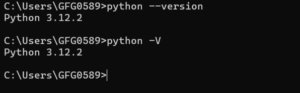
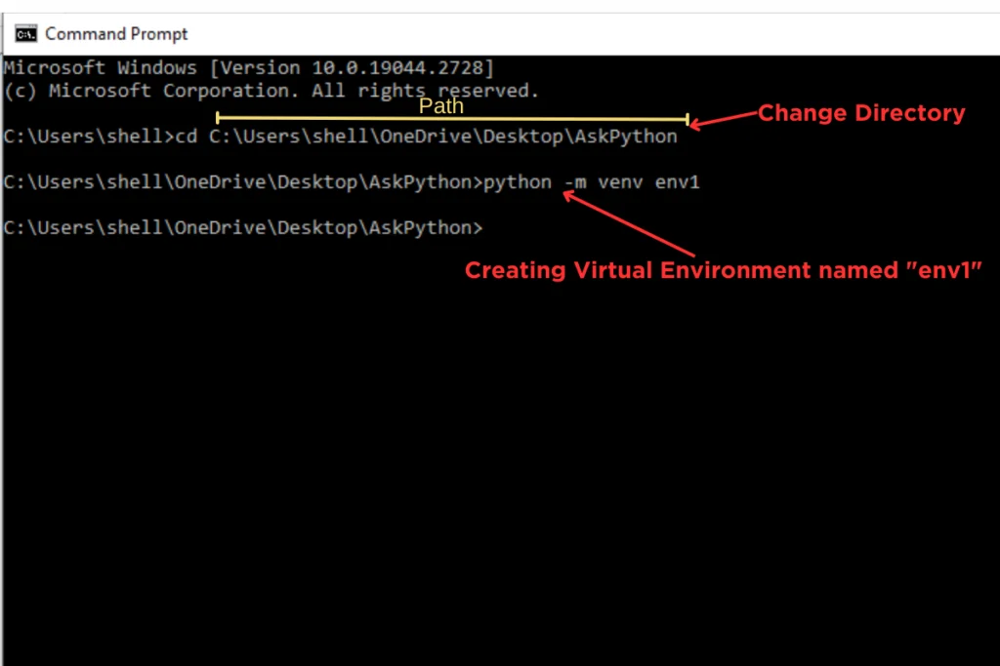
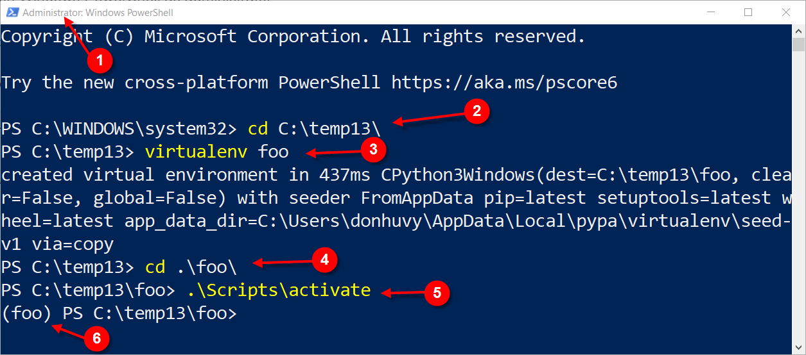

# Basic setup guide

Hello! In this module, we will guide you through the basic setup and use of the tools required for this course. Also:

- some basic units for solving numericals
- accessing command-line input using the `sys` module

> We strongly encourage you to practice the course content on a laptop and not rely on a smartphone.

## 1. Python

In this course, we will use the Python programming language for application development. Python is a **high-level, interpreted programming language** known for its simplicity and readability.

### Why Python

- Easy to learn and use.
- Extensive libraries and frameworks.
- Cross-platform compatibility.
- Strong community support.
- Versatile and can be used for web development, data analysis, artificial intelligence, scientific computing, automation, and more.

### Installation of Python

1. Open a browser and visit the official Python downloads page: [python download page](https://www.python.org/downloads/).
2. Download and install the version for your operating system.
3. During installation, make sure to **Add Python to PATH** (it is labelled *Add python.exe to PATH* in recent installers).
4. After installation, open a **new** Command Prompt (windows that were already open do not see the updated PATH) and type `python --version` -> verify if you see the installed Python version printed in the terminal. On macOS and Linux the command is usually `python3 --version`; on Windows `py --version` also works.
5. If you see an error message, revisit the installation steps and ensure that Python is added to ["Path" environment variable](https://www.architectryan.com/2018/03/17/add-to-the-path-on-windows-10/).<br> Video guide: [python installation video](https://www.youtube.com/watch?v=91SGaK7_eeY).



### Virtual Environments

Virtual environments are isolated environments that allow you to manage dependencies for different projects separately. This helps to avoid conflicts between packages required by different projects.

#### Creating a virtual environment

To create a virtual environment, open Command Prompt (or a terminal) and navigate to your project directory. Then run the following command:

```bash
python -m venv env_name

# If python does not work try one of these:
py -m venv env_name          # Windows (Python launcher)
python3 -m venv env_name     # macOS and Linux
```

Replace `env_name` with the desired name for your virtual environment.


#### Activating a virtual environment

**On Windows** (enter the following command in Command Prompt or PowerShell):

```bat
.\env_name\Scripts\activate
```

> [!NOTE]
> **PowerShell and the script execution policy**
>
> PowerShell's own activation script is `Activate.ps1`. By default Windows may refuse to run it with an error about the *script execution policy*. VS Code's terminal opens PowerShell by default on Windows, so this is a common first problem; see [Common Issues](0-vscode-setup.md#common-issues) in the VS Code note for a video guide.

**On macOS and Linux** (enter the following command in a terminal):

```bash
source env_name/bin/activate
```

#### Deactivating a virtual environment

To deactivate the virtual environment, simply run the following command:

```bash
deactivate
```

If you followed the steps correctly, you should see the virtual environment name in parentheses at the start of the Command Prompt/terminal line, e.g. `(env_name)`, indicating that the virtual environment is active.

Video guide: [python virtual environment video](https://youtu.be/Z9Vm9Uxk5pA).



*The screenshot shows PowerShell after activating an environment named `foo`. It was created with the `virtualenv` tool, which works like `python -m venv`; the `(foo)` at the start of the line shows that it is active.*

### pip - Python package installer

#### pip installation

`pip` is the package installer for Python. It is installed together with Python by the python.org installers and, through the standard-library `ensurepip` module (Python 3.4 and above), also inside every virtual environment created with `python -m venv`. Some Linux distributions ship `pip` and `venv` as separate packages (on Debian/Ubuntu: `sudo apt install python3-pip python3-venv`). To verify that `pip` is installed, open Command Prompt (or a terminal) and run `pip --version`. If the `pip` command is not found, `python -m pip --version` runs the same tool through Python.

#### Basic pip commands

- To install a package: `pip install package_name`
- To uninstall a package: `pip uninstall package_name`
- To list installed packages: `pip list`
- To print installed packages as `name==version` lines, the format of a requirements file: `pip freeze`. Save it with `pip freeze > requirements.txt` (a fresh virtual environment prints nothing, because `pip` itself is not included).
- To upgrade a package: `pip install --upgrade package_name`
- To install packages from a requirements file: `pip install -r requirements.txt`
- To uninstall packages from a requirements file: `pip uninstall -r requirements.txt` (add `-y` to skip the confirmation question for every package)
- To show information about a package: `pip show package_name`

For example, to install the Flask package, run:

```bash
pip install flask
```

**Note:** Make sure to activate your virtual environment before installing packages to ensure they are installed in the correct environment.
