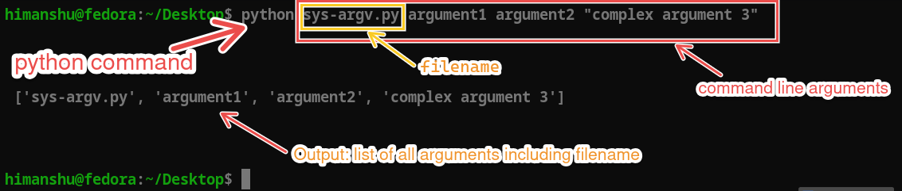

# `sys` Module

The `sys` module in Python provides access to some variables used or maintained by the interpreter and to functions that interact strongly with the interpreter. We will only cover a few important aspects of the `sys` module here.

- `sys.argv`: A list of command-line arguments passed to a Python file. The first element is the name of the file, exactly as it was typed on the command line.
- `sys.exit([arg])`: Exit from Python. This function can take an optional argument to specify the exit status.
- `sys.version`: A string containing the version of the Python interpreter. To compare versions in code, use the tuple `sys.version_info` instead, e.g. `sys.version_info >= (3, 10)`.
- `sys.platform`: A string that identifies the platform on which Python is running: `linux`, `win32` (Windows, also on 64-bit systems) or `darwin` (macOS).

## sys.argv

The `sys.argv` list contains the command-line arguments passed to the file. The first element, `sys.argv[0]`, is the name of the file itself, exactly as we typed it (for example `myfile.py`, `./myfile.py` or a full path). The subsequent elements are the arguments passed to the file.

Here is an example of how to use `sys.argv` to print the file name and its arguments:

```python
import sys
print("file name:", sys.argv[0])
```

If you run the file with arguments like this:

```bash
python myfile.py arg1 arg2
```

```txt
file name: myfile.py
```

```python
import sys
print(sys.argv)
```

If you run the file with arguments like this:

```bash
python myfile.py argument1 argument2 "complex argument 3"
```



```txt
['myfile.py', 'argument1', 'argument2', 'complex argument 3']
```

- The first element of `sys.argv` is the file name as typed: `python myfile.py` gives `myfile.py`, while `python sub/myfile.py` gives `sub/myfile.py`. (For code that does not come from a file, it is `-c` for `python -c "..."` and `-` when the code is read from standard input.)
- If no arguments are passed, `sys.argv` will contain only one element, the file name.
- Every element is a string (`str`), even if we type a number: `python myfile.py 5` gives `'5'`. Convert it with `int()` or `float()` when needed.
- Arguments are space-separated strings but we can enclose them in quotes to include spaces in arguments or name of the file. This splitting is done by the **shell** (the terminal), not by Python: the shell removes the quotes and, on Linux and macOS, also expands wildcards such as `*.txt` into a list of file names before Python even starts.

**Note: Python does not decide what arguments are — it simply receives them from the operating system as a list of strings.**

## sys.exit

`sys.exit()` stops the program by raising a `SystemExit` exception. The optional argument becomes the **exit status** that the shell receives (see it with `echo $?` on Linux/macOS or `echo %errorlevel%` on Windows Command Prompt):

- no argument, or `None`: status `0` (success)
- an integer `n`: status `n` (a non-zero status means an error)
- any other object, such as a message string: the message is printed to standard error and the status is `1`

```python
import sys
sys.exit("Something went wrong")   # prints the message to stderr, exit status 1
```

Because it is an exception, `finally` blocks still run and `except SystemExit` can catch it.

- [Inspect Developer Tools](https://youtu.be/Pf2z_Ue73qE?si=XAul5yx0EI6pAZWH)
- [sys module documentation](https://docs.python.org/3/library/sys.html)
