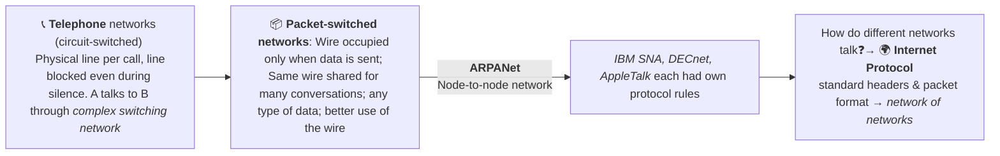
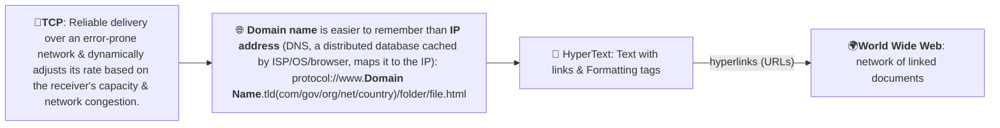
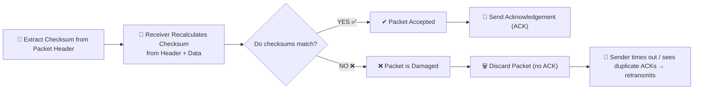
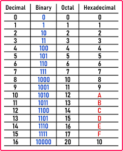

1. Who am I talking to? → IP addresses (DNS finds IP for that domain name)
2. How do I reach them? → IP routing across networks
3. How do I talk reliably? → TCP (reliable) / UDP (fast)
4. What kind of conversation is this? → Application protocols (HTTP, SMTP, SSH, SFTP)

# Historical Background of Networks





> [!TIP]
> **Web server**:
> - Listen for incoming requests on a **fixed port** → Respond
> - OS manages ports and network connections

> [!TIP]
> **Protocol** defines:
> - What a client can request from a server?
> - How the server responds to client?
> - How to format packets, place them on wire, headers/checksums

## HyperText Transfer Protocol (HTTP)
> Client to server: Give me this resource, and tell me what is the status now? (TCP handles reliability)
- Rulebook for communication between browser and server
- **Client requests server** for some data → read result → process
- **Request** = request line (method + path) + **request headers** + optional body. Request headers tell the server what the client can handle:
  - `Accept`: content types the client can deal with
  - `Accept-Language`: language
  - `Accept-Encoding`: encoding (compression)
- **Server sends response** = **status line** (status code, e.g. `200 OK`) + **response headers** + body. Response headers describe the body and how to treat it:
  - `Content-Type`, `Content-Length`, `Content-Encoding`
  - `Cache-Control`: cache info

| Method     | Meaning      | Simple Example |
| ---------- | ------------ | -------------- |
| **GET**    | Ask for data | Open a webpage, search queries |
| **POST**   | Send data    | Submit a form, upload files  |
| **PUT**    | Update (replace) data  | Edit user profile   |
| **DELETE** | Remove data  | Delete account |

You will learn about *HTTP methods* in greater detail in [Week 6](../week6/6-Rest-APIs.md)
[HTTPS is HTTP + encryption (TLS)](../week9/9-https-logging.md)

### ⭐Try it yourself: [`curl`, `python -m http.server` and `nc`](1-5-curl-http-server-netcat.md) (basics), then the [Curl Commands](../week5/5-curl-server.md#curl-commands) from Week-5

## Transmission Control Protocol
**Transport Layer that ensures data gets delivered correctly (Accuracy > Speed)**
TCP ensures reliable communication between different machines:
- reassembles packets in CORRECT ORDER

> [!WARNING]
> **Checksum**
>
> A checksum is a small number generated from the packet's header and data (TCP uses a 16-bit one's-complement sum). The receiver recalculates it: if it does not match, the packet was damaged **accidentally** while travelling.
>
> It is **not a security feature**: anyone who changes the data on purpose can simply recompute the checksum, and even some accidental changes (such as swapping two 16-bit words) give the same sum.



- dynamically adjusts sending speed based on receiver's capacity (flow control) & network overload (congestion control)

#### Ports
TCP uses 16-bit unsigned integers for port numbers
- A 16-bit number has $2^{16} = 65{,}536$ possible values, so port numbers go from 0 to 65,535 ($2^{16} - 1$).

> [!CAUTION]
> **Port 0 is reserved**
>
> If you try to bind with port 0, Operating System automatically assigns a random free port.
>
> - `127.0.0.1` is **loopback address** for "this same machine" (whispering to yourself): the traffic never leaves the machine. The whole `127.0.0.0/8` block (`127.x.x.x`) is loopback, and `localhost` normally points to `127.0.0.1`.
>
> - `0.0.0.0` binding tells the app to **listen to all interfaces (wildcard)**: it accepts connections coming through any IPv4 address of the machine, including `127.0.0.1`

<!-- Broadcast is 255.255.255.255. -->
## Internet Protocol
**Network Layer that decides where data should go**
- addressing devices with IP addresses (handed out e.g. by DHCP)
- encapsulates TCP segments into packets
- routing packets across networks
- forwarding packets from router to router (doesn't guarantee delivery or in same order like **TCP**)

packet has:
```txt
source IP address
destination IP address
payload (data)
(+ other header fields, e.g. TTL, protocol, header checksum)
```

> [!TIP]
> **TCP/IP commonly used as a pair:**
>
> | Protocol | Layer | Responsibility |
> |--------|------|----------------|
> | **IP** | Network | Where packets go |
> | **TCP** | Transport | How packets arrive correctly |
> | **HTTP** | Application | What the data means |

#### Opening a website (`https://example.com`)
1. **DHCP**  → Your device is assigned an *IP address*, gateway, and DNS server (when it joins the network).
2. **DNS**  → “What is the IP address of `example.com`?”
3. **TCP connection** → the browser connects to port 443 with the **three-way handshake** (SYN → SYN-ACK → ACK).
4. **TLS handshake** → (HTTPS only) client and server agree on encryption keys and the server proves its identity with a certificate.
5. **Application (Browser)** → Creates an **HTTPS request** and sends it over this connection
6. **TCP (Transport layer)**
   - breaks HTTP data into **segments**
   - Adds sequence numbers & `checksum` (**reliable**)
7. **IP (Network layer)**
   - Wraps TCP segments into **IP packets**
   - **route** packets hop-by-hop to destination (no guarantees)
8. **TCP (Receiver side)**
   - **Reorders packets**
   - Verifies **checksums**
   - Acknowledges what arrived; the sender retransmits whatever is not acknowledged
9. **HTTPS Server Response**
   - Sends status code `2xx` + content

#### IP Address
- Number that identifies a device's network connection (unique within its network; private ranges like `192.168.x.x` are reused in different home networks)
- IPv4: `192.168.1.1` 
  - 4 numbers of 1 byte/8-bit
  - in range 0–255, separated by dots
  - Size: `32` bits = 4 Bytes
- Typically assigned temporarily using DHCP when your device joins the network (for DHCP lease period)
- IPv6
  - 8 groups of 16-bit/2 bytes hexadecimal numbers
  - Size: `128` bits = 16 Bytes
  - Created due to IPv4 address shortage

**❓ An IPv4 address is given as: `172.16.10.25`**
Each IPv4 octet is converted to hexadecimal → combined pairwise (using 4 hexadecimal digits per group).
How will the above IPv4 address be represented in IPv6-style hexadecimal notation?

- A) `AC10:0A19:0000:0000`
- B) `0000:0000:AC10:0A19`
- C) `AC10:190A:0000:0000`
- D) `0000:AC10:0A19:0000`

<details>
<summary>Show solution</summary>

$$
\begin{align}
&\textbf{Given IPv4 address: } 172.16.10.25 \\
&\textbf{Step 1: Convert each IPv4 octet from decimal to hexadecimal} \\
&172_{10} = (10 \times 16 + 12) = AC_{16} \\
&16_{10} = (1 \times 16 + 0) = 10_{16} \\
&10_{10} = (0 \times 16 + 10) = 0A_{16} \\
&25_{10} = (1 \times 16 + 9) = 19_{16} \\
&\textbf{Step 2: Group hexadecimal values pairwise (16 bits per group)} \\
&(AC, 10) \rightarrow AC10, \quad (0A, 19) \rightarrow 0A19 \\
&\textbf{Step 3: Pad remaining groups with zeros to match IPv6 format} \\
&\text{IPv6-style representation } = 0000:0000:AC10:0A19
\end{align}
$$

Correct Answer: B) `0000:0000:AC10:0A19`

> [!NOTE]
> The question uses only 4 groups to practise the hexadecimal conversion. A real IPv6 address always has **eight** groups; an IPv4 address is embedded as the IPv4-mapped address `::ffff:ac10:0a19` (full form `0000:0000:0000:0000:0000:ffff:ac10:0a19`), which is also written `::ffff:172.16.10.25`.



</details>

👉 IP = which machine?
👉 Port = which service on that machine? 

| Port    | Service            |
| ------- | ------------------ |
| **80**  | HTTP (webpages)         |
| **443** | HTTPS (secure web) |
| **25**  | SMTP (sending email between mail servers)      |

<details>
<summary>Some terminologies</summary>

1. **DNS**: **Internet's phonebook** Convert human-friendly names to IP addresses, e.g. `www.google.com → 142.250.182.14` (an example: real addresses change over time)
2. **DHCP**: **reception desk when you're new to network!!** Automatically assign IPs to devices
3. **SSH**: lets you sit at another computer, safely, over the network. (encrypted terminal access)
4. **SMTP**: sending emails between mail servers
5. **SFTP**: transfer files **securely** (on top of SSH)

</details>


## Status codes

| Category | Code | Name | Meaning / typical example |
| --- | --- | --- | --- |
| **1xx Informational** | 100 | Continue | Headers received; the client may continue sending the request body (used with `Expect: 100-continue`) |
| **2xx Success** | 200 | OK | Request was fulfilled (GET, PUT success) |
| | 201 | Created | Resource created (POST success) |
| | 204 | No Content | Success, but no data in the response |
| **3xx Redirection** | 301 | Moved Permanently | |
| | 302 | Found | Moved temporarily |
| **4xx Client Error** | 400 | Bad Request | Invalid input: missing fields or format |
| | 401 | Unauthorized | Not logged in (token missing) |
| | 403 | Forbidden | Server refuses to authorize request, even if client is authenticated (student accessing admin) |
| | 404 | Not Found | Resource missing (course ID not found) |
| | 415 | Unsupported Media Type | Wrong Content-Type (not JSON) |
| **5xx Server Error** | 500 | Internal Server Error | A general error indicating something went wrong on the server |
| | 502 | Bad Gateway | Invalid response from a gateway or proxy (backend bug or fail) |
| | 503 | Service Unavailable | Overloaded or down (server down) |
| | 504 | Gateway Timeout | The gateway or proxy did not get a response from the backend in time |

| Web 1.0 | Web 2.0 | Web 3 |
| --- | --- | --- |
| 1990-2000 | 2004-2016 | 2016- |


<details>
<summary>TCP, UDP, Proxy, Peer-to-Peer, Broadcast, Unicast, Multicast</summary>

- **TCP (Transmission Control Protocol)** is a connection-oriented protocol that ensures ordered & reliable delivery of data between devices on a network through handshakes and acknowledgements. (✅guarantee)
- **UDP (User Datagram Protocol)** is a connectionless protocol that sends data without establishing a prior connection, prioritizing SPEED over reliability (❌guarantees) 
- **Proxy** acts as an intermediary server between clients and other servers to facilitate requests, improving security, performance, or anonymity.
- **Peer-to-Peer (P2P)** is a decentralized communication model where each device can act as both client and server, sharing resources directly without central servers.
- **Broadcast** is a one-to-all communication where data is sent from one sender to all devices on a network segment simultaneously.
- **Unicast** is a one-to-one communication where data is sent from one sender to a single specific receiver.
- **Multicast** is a one-to-many communication where data is sent from one sender to multiple specified receivers who join a multicast group, optimizing bandwidth usage.

</details>
