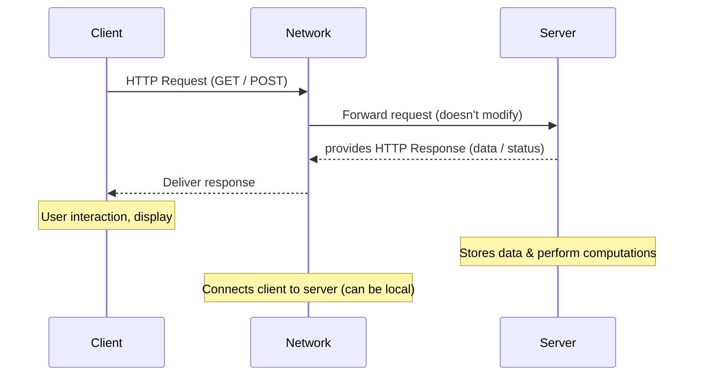
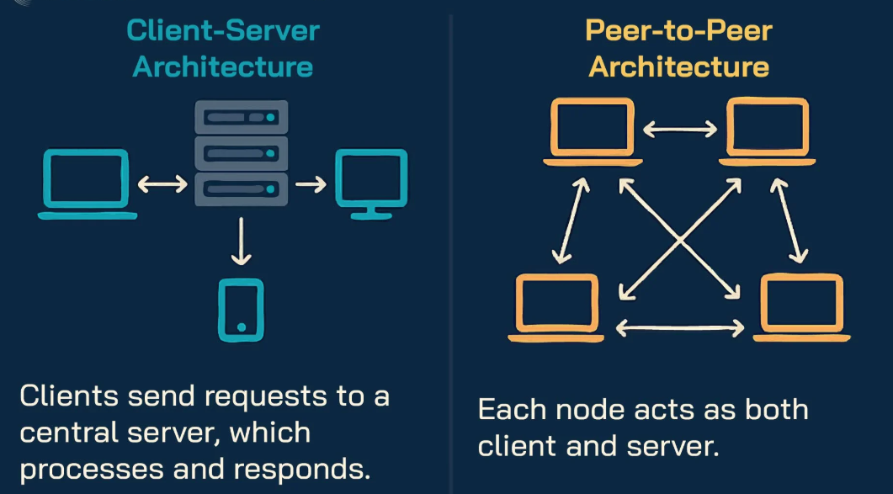

# Architectures
## Client ↔ Server Architecture

- **Client Machine**: may run without direct user interaction, e.g. software/antivirus updaters running in the *background*
- **Local Systems**: both client & server run on the same machine, like a browser accessing a `localhost` web server (e.g. the Flask development server).
- **Stateless Requests**: The server does not remember previous requests unless extra mechanisms like sessions, cookies, or tokens are used.

## Distributed or peer-to-peer Architecture

**Distributed** means the work is spread over several machines; peer-to-peer is one kind of distributed system, where all machines are equals (a client-server system with many servers is distributed too).

- All peers are considered "**equivalent**" so no permanent central controller
  - If a peer fails⚠️, automatically re-selects✅ another peer
  - The system keeps working🔁 even if some peers go offline
- Shared ℹ️information and resources among **peers**
- Ex: *BitTorrent, blockchain networks, IPFS*

> [!NOTE]
> **When you download a movie using a torrent:**
> - You download small pieces of the movie from many users
> - At the same time, you upload the pieces you already have to others
>
> 👉 So, every downloader also becomes an uploader (Data can flow in both ways)

source: [em360tech: client-server architecture](https://em360tech.com/tech-articles/client-server-architecture-enterprise-it)

Design Pattern

A general, reusable solution to a commonly occurring problem within a given context in software design. 
- Designers observe patterns → guide & reuse for faster development
- **Indexed Metadata**: time and attachments info & type; summarize basic information for tracking

### ⭐Checkout [Model-View-Controller Architecture](../week4/4-1-database-layer-MODEL.md#mvcmodel-view-controller) from Week-4
