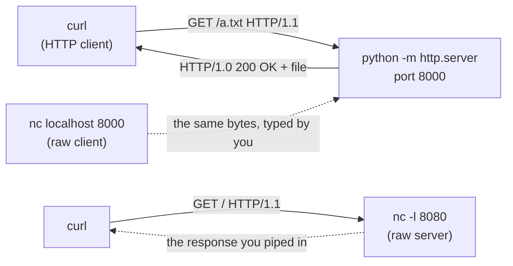

# `curl`, `python -m http.server` and `nc`: HTTP by hand

In [the HTTP section of Week 1](1-3-network-history-TCP.md#hypertext-transfer-protocol-http) we saw that HTTP is only **text sent over a TCP connection** to a port. Three small command-line tools let you play every role in that conversation yourself and see the real bytes:

| Tool | Plays the role of | Good for |
| --- | --- | --- |
| `curl` | the **client** (the browser) | sending a request and printing the response, with or without the headers |
| `python -m http.server` | a **web server** for files | serving a folder over HTTP with one command |
| `nc` (netcat) | a **raw TCP socket**, as client *or* server | sending / receiving bytes with *no* HTTP knowledge, so you write the protocol yourself |



> [!NOTE]
> All commands were run on Linux (Ubuntu, bash) with `curl 8.5`, Python 3.13 and OpenBSD `netcat`. On Windows use **WSL** (as in Week 5). `nc` is not installed by default on Windows, but section 4 has a pure-Python replacement.

To experiment, create a small folder first:

```bash
mkdir demo && cd demo
echo '<h1>Home</h1>' > index.html
echo 'plain' > a.txt
mkdir sub && echo '<h1>Sub</h1>' > sub/index.html
```

---

## 1. `curl`: the command-line HTTP client

`curl <URL>` sends **one** request (a `GET` unless told otherwise) and prints the **body** of the response. By default the headers are *not* shown.

| Command | What it does |
| --- | --- |
| `curl localhost:8000/a.txt` | `GET` the URL, print the body |
| `curl -i URL` | **i**nclude the response headers before the body |
| `curl -I URL` | send a `HEAD` request: only the status line and the headers come back |
| `curl -v URL` | **v**erbose: also show the request that was sent (`>`) and the response received (`<`) |
| `curl -s URL` | **s**ilent: no progress meter |
| `curl -o file URL` / `curl -O URL` | save the body in `file` / in a file named like the last part of the URL |
| `curl -L URL` | **l**ocation: follow redirects (`301`, `302`, ...) |
| `curl -s -o /dev/null -w '%{http_code}\n' URL` | print only the status code |
| `curl -f URL` | **f**ail: treat `4xx` / `5xx` as an error (exit code `22`) |
| `curl -d 'a=1&b=2' URL` | send the text as the request body: the method becomes `POST` and `Content-Type: application/x-www-form-urlencoded` is added |
| `curl -H 'Name: value' URL` | add / replace a request header |
| `curl -X PUT URL` | use another method |
| `curl -m 3 URL` | give up after 3 seconds |

More options (JSON, file upload, timing) are in the [Week 5 curl table](../week5/5-curl-server.md#curl-commands).

> [!TIP]
> When the output is redirected or piped (`> file`, `| less`, `-o file`), `curl` prints a **progress meter** on the error stream. `-s` hides it.

### Reading `curl -v`

Start the server of section 2 (`python -m http.server 8000`) in the `demo` folder and run `curl -v localhost:8000/a.txt` in a second terminal (trimmed):

```txt
* Connected to localhost (127.0.0.1) port 8000
> GET /a.txt HTTP/1.1
> Host: localhost:8000
> User-Agent: curl/8.5.0
> Accept: */*
>
* HTTP 1.0, assume close after body
< HTTP/1.0 200 OK
< Server: SimpleHTTP/0.6 Python/3.13.18
< Date: Thu, 12 Nov 2026 13:29:17 GMT
< Content-type: text/plain
< Content-Length: 6
< Last-Modified: Thu, 12 Nov 2026 13:22:36 GMT
<
plain
```

- `>` lines are the **request** curl sent: request line (method, path, version), then the request headers, then an empty line.
- `<` lines are the **response**: status line, response headers, an empty line, then the body.
- `*` lines are information from curl itself (connection, TLS, ...).

### Exit codes: `curl` succeeded does not mean the request succeeded

| Exit code | Meaning | Example |
| --- | --- | --- |
| `0` | curl got **an** HTTP response, whatever its status code | a `404 Not Found` page also gives `0` |
| `6` | could not resolve the host name | `curl http://no-such-host.invalid/` |
| `7` | could not connect: nothing listens on that host and port | the server is not running, or wrong port |
| `18` | the response ended before `Content-Length` bytes arrived | see section 4 |
| `22` | HTTP error status, **only with `-f`** | `curl -f localhost:8000/nope` |
| `28` | timeout, **only with `-m`** | a server that never closes the connection |

---

## 2. `python -m http.server`: a web server in one command

```bash
python -m http.server
```

```txt
Serving HTTP on 0.0.0.0 port 8000 (http://0.0.0.0:8000/) ...
```

- Python runs its standard-library module `http.server` as a program (`-m`).
- It serves the files of the **current working directory**, so `cd` into the folder first.
- Default port is **8000**. Open `http://localhost:8000` in the browser. `Ctrl+C` stops it.
- `0.0.0.0` means "listen on **all** network interfaces" (see [ports and `0.0.0.0` in Week 1](1-3-network-history-TCP.md#ports)): the folder is reachable from other devices on your network too.
- On Windows without the `python` alias use `py -m http.server`; on Linux / macOS it may be `python3`.

| Option | Example | Effect |
| --- | --- | --- |
| port (positional) | `python -m http.server 9000` | listen on port 9000 (`0` lets the OS choose a free port and prints it) |
| `-b` / `--bind` | `python -m http.server -b 127.0.0.1` | listen on this address only; `127.0.0.1` = this machine only |
| `-d` / `--directory` | `python -m http.server -d demo` | serve another folder, no `cd` needed |
| `--protocol` | `python -m http.server --protocol HTTP/1.1` | answer with HTTP/1.1 (keep-alive connections) instead of the default `HTTP/1.0` |

Every request is logged in the terminal (client address, time, request line, status code, size):

```txt
127.0.0.1 - - [12/Nov/2026 13:22:38] "GET / HTTP/1.1" 200 -
127.0.0.1 - - [12/Nov/2026 13:22:38] "GET /sub HTTP/1.1" 301 -
127.0.0.1 - - [12/Nov/2026 13:22:38] code 404, message File not found
127.0.0.1 - - [12/Nov/2026 13:22:38] "GET /nope HTTP/1.1" 404 -
```

### What the server does with a URL

| Request | Result |
| --- | --- |
| `GET /a.txt` | `200`, the file; `Content-type` is guessed from the extension (`.txt` → `text/plain`, `.html` → `text/html`) |
| `GET /` or `GET /sub/` | the folder's `index.html` if there is one, otherwise an automatic file listing (section 3) |
| `GET /sub` (no `/` at the end) | `301 Moved Permanently` with `Location: /sub/` (add `-L` to let curl follow it) |
| `GET /nope` | `404 File not found` |
| `GET /../../etc/passwd` | `404`: the server does not leave the served folder |
| `HEAD /a.txt` | headers only (this is what `curl -I` sends) |
| `POST /` (or `PUT`, `DELETE`) | `501 Unsupported method`: it only knows how to **read** files |

Response headers worth noticing: `Server: SimpleHTTP/0.6 Python/3.x`, `Content-type`, `Content-Length`, `Last-Modified`. The status line says `HTTP/1.0` by default: the connection is closed after every response.

> [!WARNING]
> **Only for learning and quick file sharing, never for a real website.** There is no HTTPS, no login and no access control. *Every* file in the folder is served, including hidden ones such as `.env`, and with the default address the folder is visible to everyone who can reach your machine (the same Wi-Fi, for example). On a shared network use `--bind 127.0.0.1`.

If you start a second server on a port that is taken, Python stops with `OSError: [Errno 98] Address already in use` (Linux): stop the first one or pick another port.

---

## 3. Why `index.html` matters

A browser asks for a **path** (`/`, `/sub/`, `/a.txt`), not for a file name. For `http://localhost:8000/` the path `/` is a *folder*, so the server has to decide what to send back. The usual answer is a **default document** in that folder, and the conventional name is **`index.html`**.

> [!IMPORTANT]
> `index.html` is not special to HTML or to the browser. It is a **server convention** ("when the URL is a folder, send the `index.html` inside it"). The name is configurable in real servers (`DirectoryIndex` in Apache, the `index` directive in nginx), but `index.html` is the default almost everywhere, including static hosts such as GitHub Pages.

What `python -m http.server` sends for `GET /` (tested):

| What is in the folder | Response |
| --- | --- |
| `index.html` | the page itself (`200`, `Content-type: text/html`) |
| nothing like an index file | an **automatic listing** titled "Directory listing for /" with a link to every file and folder |
| only `index.htm` | `index.htm` is served (it is the second choice) |
| both `index.html` and `index.htm` | `index.html` wins |
| `Index.html` (capital `I`) on Linux | **not recognised**: you get the listing, because file names are case-sensitive on Linux |

The last row is a classic deployment bug: the site worked on a laptop and shows a file listing (or an error) on the Linux server. Always name it exactly `index.html`.

- **The same rule applies in every folder.** `/sub/` is answered with `sub/index.html`, so `/sub/` is a clean URL for a page without writing `index.html` in it.
- **The trailing slash matters.** `/sub` is answered with a `301` to `/sub/` (see the table in section 2). The reason is that relative links inside the page are resolved against the *folder* of the URL: a link `page2.html` on `/sub/` means `/sub/page2.html`, but on `/sub` it would mean `/page2.html`.
- **Listings are a leak.** An automatic listing shows every file name to the visitor. Production servers normally have it switched off and answer `403` / `404` instead.
- **Flask has no such folder.** There the route `@app.route("/")` plays the role of `index.html` (see [Flask basics](../week4/4-3-flask-basics.md)).

### Why serve the folder instead of double-clicking `index.html`?

Opening the file shows it with a `file://` address, not `http://`. Same page, tested in Chromium:

| Page with `<link rel="stylesheet" href="/style.css">` and `fetch('data.json')` | `file:///.../index.html` | `http://localhost:8000/` |
| --- | --- | --- |
| `/style.css` (root-relative link) | looked for `file:///style.css`: **style not applied** | the file from the served folder: **style applied** |
| `fetch('data.json')` | **blocked** by the browser | works |

A real server is therefore needed as soon as a page uses root-relative links, `fetch`/AJAX or anything else that expects HTTP. This is the first reason to learn `python -m http.server`.

---

## 4. `nc` (netcat): raw TCP, so you write the HTTP yourself

`nc` copies **what you pipe into it** to a TCP connection and prints **what arrives** on stdout. It knows nothing about HTTP: it does not add a status line, headers or an empty line. That is exactly why it is a good tool to learn what HTTP really is.

### 4.1 Which `nc` do I have?

There are several programs called `nc`, with slightly different options. Check the first line of `nc -h`.

| Variant | `nc -l 8080` listens on 8080 | `nc -l -p 8080` | Closes the connection when its input ends |
| --- | --- | --- | --- |
| **OpenBSD netcat** (`netcat-openbsd`, the Ubuntu / Debian default; `nc -h` starts with "OpenBSD netcat") | yes | yes (Debian / Ubuntu build) | **no**, unless `-N` is given |
| **Traditional netcat** (`netcat-traditional`, `nc.traditional`) | **no**, it needs `-p`: without it nothing listens on 8080 (curl: `Connection refused`) | yes | **no**, unless `-q 0` is given |
| **Ncat** (from the Nmap project) | yes | yes | yes |

Rule of thumb: try `nc -l 8080`; if the client cannot connect, use `nc -l -p 8080`.

> [!TIP]
> The "does not close" column causes the most confusing hang, so the examples below always send a **`Content-Length`** header (curl then knows where the body ends without waiting for the connection to close). This works the same on all three variants.

### 4.2 `nc` as a client: type a request by hand

With a server running (`python -m http.server 8000` in `demo`):

```bash
printf 'GET / HTTP/1.1\r\nHost: localhost\r\nConnection: close\r\n\r\n' | nc localhost 8000
```

```txt
HTTP/1.0 200 OK
Server: SimpleHTTP/0.6 Python/3.13.18
Date: Thu, 12 Nov 2026 13:23:03 GMT
Content-type: text/html
Content-Length: 14
Last-Modified: Thu, 12 Nov 2026 13:22:36 GMT

<h1>Home</h1>
```

This is what `curl -i localhost:8000/` does, written out by hand:

- the **request line** `GET / HTTP/1.1`, then the headers `Host: ...` and `Connection: close`;
- every line ends with `\r\n` (carriage return + line feed) and the header section ends with an **empty line** (`\r\n\r\n`). Without that empty line the server keeps waiting for the rest of the request;
- `Connection: close` asks the server to close the connection after the response. Against an HTTP/1.1 server (`--protocol HTTP/1.1`) that keeps connections open, `nc` would otherwise sit there until the server gives up (the default `HTTP/1.0` server closes by itself).

> [!WARNING]
> Use **`printf`**, not `echo -e`, to produce `\r\n`. In `sh` / `dash` (what `/bin/sh` is on Ubuntu) `echo -e "a\r\nb"` prints a literal `-e` first.

### 4.3 `nc` as a server: hosting a string

```bash
printf 'HTTP/1.1 200 OK\r\nContent-Type: text/plain\r\nContent-Length: 12\r\nConnection: close\r\n\r\nHello, world' | nc -l 8080
```

In a second terminal:

```bash
curl -i localhost:8080
```

```txt
HTTP/1.1 200 OK
Content-Type: text/plain
Content-Length: 12
Connection: close

Hello, world
```

The browser works too: open `http://localhost:8080` and the text appears. What was piped into `nc`:

| Part | Why it is there |
| --- | --- |
| `HTTP/1.1 200 OK\r\n` | **status line**: version, code, reason |
| `Content-Type: text/plain\r\n` | tells the client how to treat the body. Without it the browser has to guess from the content, so always send it |
| `Content-Length: 12\r\n` | the body is exactly 12 **bytes** |
| `Connection: close\r\n` | "I will close the connection after this response" |
| `\r\n` | the **empty line** that ends the headers |
| `Hello, world` | the **body** (the string we host) |

Things to know:

**`nc` serves one connection and exits.** After the first client the command ends; the second `curl` gets `Connection refused` (exit code `7`).

**`nc` prints the request it received.** Look at the terminal where `nc -l 8080` runs: it shows exactly what curl (or the browser) sent, the same lines you saw after `>` in `curl -v`:

```txt
GET / HTTP/1.1
Host: localhost:8080
User-Agent: curl/8.5.0
Accept: */*
```

Pipe the request somewhere with `nc -l 8080 > request.txt` to keep it. Posting with `curl -d 'name=Ada&age=20' localhost:8080` shows a `POST / HTTP/1.1` request with `Content-Length: 15`, `Content-Type: application/x-www-form-urlencoded` and the body `name=Ada&age=20` after the empty line.

**`Content-Length` must match the number of bytes of the body.** Count bytes, not characters (`printf %s "$body" | wc -c`; `é` is 2 bytes in UTF-8). If it is wrong:

| Header says | Body really is | Result in curl |
| --- | --- | --- |
| `5` | `Hello, world` (12 bytes) | prints only `Hello`, the rest is ignored |
| `20` | `Hello, world` (12 bytes) | prints `Hello, world`, then curl keeps waiting for the 8 missing bytes. When `nc` closes the connection (`Ctrl+C` in the `nc` terminal, or `nc -N`) curl ends with `curl: (18) transfer closed with 8 bytes remaining to read` |

**Keep it running with a loop.** The loop starts a new `nc` for every request, so the string can change each time:

```bash
while true; do
  body="$(date)"
  printf 'HTTP/1.1 200 OK\r\nContent-Type: text/plain\r\nContent-Length: %s\r\nConnection: close\r\n\r\n%s' "$(printf %s "$body" | wc -c)" "$body" | nc -l 8080
done
```

Every `curl localhost:8080` now prints a time, but **not the time of your request**: `$(date)` runs when the loop round **starts**, i.e. when you started the loop or right after the previous request was answered, *before* `nc` waits for the next client. Start the loop, wait ten seconds, then `curl`: the reply is ten seconds old. (The Week 5 loop has the same property.) A real web server builds the response *after* the request arrives; that is what Flask does for you in Week 4. Stop the loop with `Ctrl+C`.

**Without `Content-Length`**, on OpenBSD netcat the client gets the body but keeps waiting for the connection to close. Add **`-N`** to `nc` (OpenBSD: close the socket when input ends) or `-q 0` (traditional netcat). The Week 5 loop `echo -e ... | nc -l -p 1500` has no `Content-Length`: on OpenBSD netcat curl prints the date and then hangs until `Ctrl+C`.

**`nc -k -l`** (keep listening) does not repeat the piped string: stdin is used up by the first client, so the second client gets no response (curl waits until it times out). Use the loop.

**A bare string is not HTTP.** `echo hello | nc -l 8080` sends `hello` with no status line, so the clients complain:

| Client | Reaction |
| --- | --- |
| `curl localhost:8080` | `curl: (1) Received HTTP/0.9 when not allowed` |
| Chromium | `net::ERR_INVALID_HTTP_RESPONSE` |
| `curl --http0.9 localhost:8080` | prints `hello` |
| `nc localhost 8080` | prints `hello` (a raw TCP client does not care), then waits; stop it with `Ctrl+C`, because a plain `nc -l` does not close the connection |

So for a **browser or curl** the string needs the HTTP wrapper above; for a **raw TCP client** the bare string is enough.

**Who can connect?** `nc -l 8080` listens on **all** interfaces (`0.0.0.0`), like `http.server`. Add an address to restrict it: `nc -l 127.0.0.1 8080` (this machine only).

Ports below 1024 normally need administrator rights, so use `8080` and friends.

### 4.4 The same string server in Python (no `nc` needed)

```python
import socket

body = b"Hello, world"
head = b"HTTP/1.1 200 OK\r\nContent-Type: text/plain\r\nContent-Length: %d\r\nConnection: close\r\n\r\n" % len(body)

with socket.create_server(("127.0.0.1", 8080)) as server:
    while True:
        conn, addr = server.accept()      # wait for a client
        with conn:
            conn.recv(4096)               # read (a part of) the request and ignore it
            conn.sendall(head + body)     # status line + headers + empty line + body
```

It is the same idea with the operating-system calls visible: `accept()` waits for a client, `sendall()` writes the response, leaving the `with` block closes the connection (so there is no hang). Because it works with plain `socket`, it also runs on Windows. It is also a first look at what Flask does for you in Week 4.

---

## 5. All three together (10-minute lab)

1. In `demo`, run `python -m http.server 8000`.
2. In a second terminal: `curl -i localhost:8000/` and then `curl -v localhost:8000/sub` and `curl -L localhost:8000/sub`. Which status code and which `Location` header do you see?
3. Rename `index.html` to `Index.html`, reload `http://localhost:8000/`. What do you see? Rename it back.
4. Stop the server. Run `nc -l 8080` **alone** (nothing piped) and open `http://localhost:8080` in the browser. The request headers of your browser appear in the terminal. Compare them with the `>` lines of `curl -v`.
5. Start the one-line string server of section 4.3 and open it in the browser. Change `Content-Length` to `5` and see what happens.

## 6. When something goes wrong

| Symptom | Likely cause |
| --- | --- |
| `curl: (7) Failed to connect ... Connection refused` | nothing listens on that port: server not started, already exited (`nc` serves one connection), wrong port, or traditional `nc` without `-p` |
| `OSError: [Errno 98] Address already in use` | another program already uses the port: stop it or choose another port |
| curl prints the body but never returns | the server never closes the connection and sent no `Content-Length` (`nc` without `-N`); `Ctrl+C`, or use `-m 3` to give up |
| curl keeps waiting after the body, then `curl: (18) transfer closed with ... bytes remaining` once the server closes | `Content-Length` is larger than the body that was sent |
| body cut short | `Content-Length` is smaller than the real body |
| `curl: (1) Received HTTP/0.9 when not allowed` / `ERR_INVALID_HTTP_RESPONSE` | the server sent no status line: it is not speaking HTTP |
| `501 Unsupported method ('POST')` | `http.server` only serves files; use Flask (Week 4) for forms and APIs |
| file listing instead of your page | there is no `index.html` in that folder, or the name has a different case |

## Practice

#### Exercise 1
Write one command that serves the folder `site` on port 9000 and only to your own machine.

<details>
<summary>Answer</summary>

```bash
python -m http.server 9000 --bind 127.0.0.1 --directory site
```

`--bind 127.0.0.1` restricts it to this machine, `--directory site` avoids the `cd`.

</details>

#### Exercise 2
`curl localhost:8000/sub` prints nothing, but `curl -i` shows `301`. Why, and how do you get the page?

<details>
<summary>Answer</summary>

The server redirects the folder URL `/sub` to `/sub/` (`Location: /sub/`) and curl does not follow redirects by default. Use `curl -L localhost:8000/sub` or ask for `curl localhost:8000/sub/` directly.

</details>

#### Exercise 3
What does `curl localhost:8080` print for `printf 'HTTP/1.1 200 OK\r\nContent-Length: 5\r\n\r\nHello, world' | nc -l 8080`, and what changes if the header says `Content-Length: 20`?

<details>
<summary>Answer</summary>

With `5` it prints `Hello`: the client reads exactly 5 bytes and ignores the rest. With `20` it prints `Hello, world` and then keeps waiting for the 8 missing bytes. As soon as the connection is closed (`Ctrl+C` in the `nc` terminal, or `nc -N`) it fails with `curl: (18) transfer closed with 8 bytes remaining to read` (exit code 18).

</details>

#### Exercise 4
Why does a browser show an error for `echo hello | nc -l 8080`, while `nc localhost 8080` prints `hello`?

<details>
<summary>Answer</summary>

A browser expects an HTTP response (a status line, headers, an empty line, then the body) and rejects the bare string (`ERR_INVALID_HTTP_RESPONSE`). `nc localhost 8080` is a raw TCP client: it prints whatever bytes arrive, whatever protocol they follow.

</details>

---

## Summary

| Tool | One-line summary | Remember |
| --- | --- | --- |
| `curl` | HTTP client | `-i` headers, `-v` request + response, `-L` redirects, `-d` POST body; exit code `0` even for `404` unless `-f` |
| `python -m http.server [PORT]` | static file server for the current folder | default `0.0.0.0:8000`, `--bind` / `--directory`, `GET` and `HEAD` only, for learning only |
| `index.html` | the default document of a folder | a server convention, case-sensitive on Linux; without it the server lists the files (or refuses) |
| `nc` | raw TCP client / server | speaks no HTTP: send the `\r\n`-separated status line, headers, empty line and body yourself, with a correct `Content-Length` |

## Extra Resources

- [Python docs: `http.server`](https://docs.python.org/3/library/http.server.html)
- [Everything curl (free book)](https://everything.curl.dev/)
- [MDN: HTTP messages](https://developer.mozilla.org/en-US/docs/Web/HTTP/Messages)
