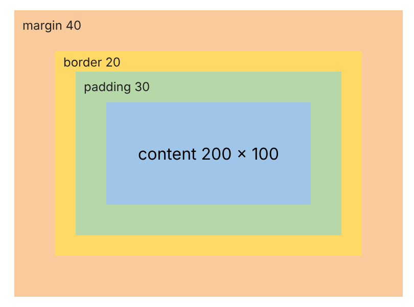
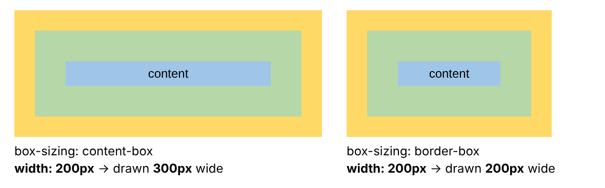

# The CSS Box Model

> [!NOTE]
> **Prerequisite:** the previous pages on [CSS selectors and specificity](2-6-css-selector-specificity.md) (a short version of this topic is in "Margins, height, width, padding" there) and on [`display`](2-6-css-selector-specificity.md#css-display-property).

Every element on a web page is drawn as a **rectangular box**. The browser decides the size and position of every box before it paints anything, so to control a layout (spacing, alignment, why a box is "too wide") we must know how the size of a box is made up. This description is called the **CSS box model**.

## 1. Every element is a box with four layers



From the inside to the outside:

| Layer | What it is | Background of the element | Set with |
| ----- | ---------- | ------------------------- | -------- |
| **Content** | The text, image or child elements | Painted | `width`, `height` |
| **Padding** | Space between the content and the border | Painted (it is inside the element) | `padding` |
| **Border** | A line around the padding | Is the border itself | `border` |
| **Margin** | Space between this box and its neighbours | Never painted: always transparent | `margin` |

- The content + padding + border together are the **border box**: this is what we see, and what a click, a `:hover` and a background belong to.
- The **margin** is not part of the visible element. It only keeps other boxes away.
- By default the background colour is painted under the content, the padding **and the border** (`background-clip: border-box`), which is why a dashed or semi-transparent border shows the background through its gaps.

<details>
<summary>How the picture above was made (a real element, not a drawing)</summary>

The box is a real `<div>` with the CSS below. The orange wrapper is an `inline-block`, so it grows to contain the margin of the box inside; that is how the (transparent) margin gets a colour in the picture. The small labels are absolutely positioned.

```css
/* diagram */
.box {
  width: 200px;
  height: 100px;
  padding: 30px;
  border: 20px solid #ffd966;
  margin: 40px;
  line-height: 100px;
  text-align: center;
  background: linear-gradient(#9fc5e8, #9fc5e8) content-box, #b6d7a8;
}
```

```html
<div id="diagram" style="display: inline-block; position: relative; background: #f9cb9c;">
  <div class="box">content 200 × 100</div>
  <span style="position: absolute; left: 8px; top: 8px;">margin 40</span>
  <span style="position: absolute; left: 48px; top: 44px;">border 20</span>
  <span style="position: absolute; left: 68px; top: 68px;">padding 30</span>
</div>
```

</details>

## 2. Width and height are the size of the content

In the standard (default) box model, `width` and `height` set the size of the **content box** only. Padding and border are **added** on the outside:

```css
.box {
  width: 200px;       /* content width  */
  height: 100px;      /* content height */
  padding: 30px;
  border: 20px solid #ffd966;
  margin: 40px;
}
```

$$\text{border-box width} = \underbrace{200}_{\text{content}} + \underbrace{2 \times 30}_{\text{padding}} + \underbrace{2 \times 20}_{\text{border}} = 300\text{px}$$

$$\text{border-box height} = 100 + 2 \times 30 + 2 \times 20 = 200\text{px}$$

| Box | Width | Height |
| --- | ----- | ------ |
| Content box | 200px | 100px |
| Padding box (content + padding) | 260px | 160px |
| **Border box** (what is drawn) | **300px** | **200px** |
| Margin box (the space it takes in the layout) | 380px | 280px |

So `width: 200px` does **not** make the element 200px wide on the screen; it is 300px wide. This is the most common surprise with the box model (see `box-sizing` in section 7 for the cure).

> [!TIP]
> **Check it yourself:** put the CSS on a `<div>`, open the browser's developer tools (right click → Inspect) and look at the **Computed** tab: it draws exactly this diagram with the numbers of the selected element.

## 3. The shorthand: 1, 2, 3 or 4 values

`padding`, `margin`, `border-width`, `border-style` and `border-color` accept one to four values, always in the order **top, right, bottom, left** (clockwise, starting at the top). Missing values are copied from the opposite side:

| Written | Top | Right | Bottom | Left |
| ------- | --- | ----- | ------ | ---- |
| `padding: 10px` | 10px | 10px | 10px | 10px |
| `padding: 10px 20px` | 10px | 20px | 10px | 20px |
| `padding: 10px 20px 30px` | 10px | 20px | 30px | 20px |
| `padding: 10px 20px 30px 40px` | 10px | 20px | 30px | 40px |

The single sides have their own properties: `padding-top`, `margin-left`, `border-bottom`, ... (`margin-inline` / `padding-block` and friends are the newer, writing-direction aware versions).

## 4. Padding

- Space **inside** the box, between the content and the border; the element's background shows in it.
- It can **not** be negative (`padding: -5px` is invalid and ignored).
- A percentage is calculated from the **width** of the containing block, for all four sides. Inside a 400px wide parent, `padding: 10%` is 40px on the top, right, bottom **and** left.

## 5. Border

A border has three parts: `border-width`, `border-style` and `border-color`. The shorthand `border: 5px solid red;` sets all three (for all four sides); `border-top`, `border-left`, ... set one side.

> [!WARNING]
> **A border without a `border-style` is not drawn, and has no width.** The default style is `none`, and with style `none` the width is computed as `0px`, even if we wrote `border-width: 5px`. Always give a style (`solid`, `dashed`, `dotted`, ...).

- The default `border-width` (when a style is given but no width) is `medium`, which is `3px`.
- The default colour is `currentcolor`: the `color` of the element's text.
- `border-radius` rounds the corners but does **not** change the size of the box (a `100px` square with `10px` padding stays `120px`).
- Width can not be negative.

## 6. Margin

- Space **outside** the border; it is always transparent and it is not part of the element's clickable area.
- Unlike padding, a margin **can be negative**: the box is pulled towards (and may overlap) its neighbour. With `margin-top: -20px` the box moves 20px up; with a negative `margin-left` on a block whose `width` is `auto`, the box also grows to the left.
- A percentage is calculated from the **width** of the containing block, also for `margin-top` and `margin-bottom`.

### `margin: auto`

A **block** element with a `width` and `margin-left: auto; margin-right: auto` (usually written `margin: 0 auto`) is centred horizontally: the free space is split equally between the left and the right margin. In a `1000px` wide parent a `200px` wide box gets `400px` on each side.

- Without a `width` the box already fills the whole line, so there is no free space and `auto` is `0`.
- `margin-top: auto` and `margin-bottom: auto` are `0` in the normal flow: auto margins do not centre a box vertically there. Inside a **flex container** `margin: auto` does centre the box on both axes.

### Margin collapsing

When the **vertical** margins of two blocks touch, they do not add up: they **collapse** into one margin.

| Situation | Space between the two boxes |
| --------- | --------------------------- |
| `margin-bottom: 20px` above `margin-top: 30px` | **30px** (the larger one, not 50px) |
| `30px` above `30px` | 30px |
| `30px` above `-10px` | **20px** (largest positive + smallest negative) |
| `-10px` above `-30px` | **-30px** (both negative: the most negative one; the boxes overlap) |
| The same margins on **flex items**, grid items or floats | they **add up** (50px): no collapsing (absolutely positioned boxes never collapse either) |
| Left and right margins, e.g. `20px` + `30px` next to each other | they **add up** (50px): only vertical margins collapse |
| An empty block (no height, padding or border) between two blocks | its own margins collapse **through** it: the largest of all of them (30px for 20, 10, 30, 5) |

**A parent and its first child.** If the parent has no top padding, no top border and nothing that separates them, the `margin-top` of the first child collapses with the parent's: the margin does not appear *inside* the parent, the whole parent is pushed down instead.

```html
<div id="parent">
  <div id="child"></div>
</div>
```

With `#child { margin-top: 40px; height: 50px; }`:

| Parent CSS | Where the parent starts | Where the child starts | Height of the parent |
| ---------- | ----------------------- | ---------------------- | -------------------- |
| *(nothing)* | 40px (pushed down) | 40px (same place) | 50px |
| `padding-top: 1px` or `border-top: 1px solid` | 0px | 41px (margin is inside) | 91px |
| `overflow: hidden` | 0px | 40px | 90px |
| `display: flow-root` | 0px | 40px | 90px |
| `display: flex` | 0px | 40px | 90px |

`display: flow-root` is the clean way to say "contain the margins of my children" without side effects; padding or a border also separate the margins.

## 7. `box-sizing`: what do `width` and `height` mean?

`box-sizing` chooses the box that `width` and `height` describe:

| Value | `width` / `height` set the | The element is drawn |
| ----- | -------------------------- | -------------------- |
| `content-box` (default) | content box | `width` + padding + border wide |
| `border-box` | border box (content + padding + border) | exactly `width` wide; the content shrinks |



The two boxes above have **exactly the same CSS** (`width: 200px; padding: 30px; border: 20px solid`), only `box-sizing` differs: the first is `300px` wide, the second `200px` wide with a content of `100px`. These two declarations make the same box as the one in section 2:

```css
.a { box-sizing: content-box; width: 200px; height: 100px; padding: 30px; border: 20px solid; }
.b { box-sizing: border-box;  width: 300px; height: 200px; padding: 30px; border: 20px solid; }
```

### Why most people use `border-box`

With `content-box` we have to add up padding and border to know the real size, and a "full width" box overflows its parent as soon as it has padding:

| Child of a 400px wide parent | `content-box` | `border-box` |
| ---------------------------- | ------------- | ------------ |
| `width: 100%; padding: 20px; border: 5px solid;` | **450px** (overflows by 50px) | 400px |
| `width: auto; padding: 20px; border: 5px solid; margin: 0 10px;` | 380px (content 330px) | 380px (`auto` always fills the space) |
| `max-width: 100px; padding: 20px; border: 5px solid;` | 150px | 100px |

`min-width` and `max-width` follow `box-sizing` in the same way. With `border-box` the content can never become negative: `width: 20px; padding: 30px` is drawn `60px` wide (the padding alone), `width` can not be smaller than padding + border.

The usual reset (put it at the top of the stylesheet) gives every element the more intuitive `border-box`:

```css
*, *::before, *::after {
  box-sizing: border-box;
}
```

> [!NOTE]
> `box-sizing` is **not inherited**: a child of a `border-box` element is `content-box` again, unless the rule matches the child too (that is why the reset uses `*`).

If we stay with `content-box` we can still fill the parent with `calc()`: `width: calc(100% - 2 * 20px - 2 * 5px)` with `padding: 20px; border: 5px solid` is exactly `400px` in a `400px` parent.

## 8. Width, height and overflow

- `width: auto` (default for blocks): the box fills its parent; margin, border and padding are taken out of that width and the **content gets what remains**.
- `width: 50%`: a percentage of the **content width of the containing block**. `height: 50%` only works if the parent has a definite height.
- `min-width`, `max-width`, `min-height`, `max-height` limit the size and override `width` / `height`; if `min-width` and `max-width` disagree, `min-width` wins (see the table above for the effect of `box-sizing`).
- `height: auto` (default): the box is as tall as its content.

When the content is larger than the box (a fixed `height`, a long word, a wide image) the box keeps its size and the content **overflows**. `overflow` decides what is done with it:

| `overflow` | Result |
| ---------- | ------ |
| `visible` (default) | The content spills out of the box, over the neighbours |
| `hidden` | The part outside is cut off |
| `scroll` / `auto` | Scrollbars appear (always / only when needed) |

In JavaScript `scrollWidth` and `scrollHeight` give the size of the whole content, even when only a part is visible (a `100×50` box with a `300×200` child: `scrollWidth` is `300`, `scrollHeight` is `200`).

## 9. Block, inline and inline-block boxes

The `display` of an element decides which parts of the box model apply:

| | `display: block` | `display: inline` | `display: inline-block` |
| - | ---------------- | ----------------- | ----------------------- |
| Starts on a new line | Yes | No | No |
| `width` / `height` | Yes | **Ignored** (not for replaced elements such as ``) | Yes |
| Left / right margin and padding | Yes | Yes | Yes |
| Top / bottom **margin** | Yes | **Ignored** | Yes |
| Top / bottom **padding** and border | Yes (they push the neighbours) | Painted, but they **do not push** the lines around | Yes |

Example: a `<span>` with `margin: 50px 30px; padding: 40px 10px;` inside a paragraph of `20px` line height: the horizontal margin (`30px`) and padding work, the vertical margin is ignored, and the vertical padding is painted over the lines above and below, but the paragraph stays `20px` tall and the next paragraph starts right below it. If we need the vertical spacing, we use `display: inline-block` (or `block`).

## 10. `outline` and `box-shadow` are not part of the box

- `outline` (the focus ring around a link or an input) and `box-shadow` are painted **around** the border box but take **no space**: they never change the size of the element or move the neighbours, and they may overlap them.
- That is why `outline` is used for `:focus` (nothing jumps), while `border` is used for permanent lines.

## 11. Measuring a box

For the element of section 2 (`width: 200px; height: 100px; padding: 30px; border: 20px solid`):

| JavaScript | Gives | Value |
| ---------- | ----- | ----- |
| `getComputedStyle(el).width` | the value of the property: the **content** width for `content-box`, the **border-box** width for `border-box` | `"200px"` (and `"300px"` for the `border-box` version `.b` of section 7) |
| `el.clientWidth` | content + padding (without border and scrollbar) | `260` |
| `el.offsetWidth` | content + padding + border (the border box) | `300` |
| `el.getBoundingClientRect().width` | the border box, on the screen | `300` |

The margin is not included in any of them; the margin box is `offsetWidth + marginLeft + marginRight`.

## 12. Default spacing of the browser

Browsers give some elements a margin or padding with their own default stylesheet (these are the values of Chrome, `16px` font):

| Element | Default |
| ------- | ------- |
| `body` | `margin: 8px` (the gap between a page and the window edge) |
| `p` | `margin: 1em 0` (`16px` above and below) |
| `h1` | `margin: 0.67em 0` (about `21px` above and below) |
| `ul`, `ol` | `padding-left: 40px` (room for the bullets), `margin: 1em 0` |
| `div` | `0` |

Many stylesheets start with a reset such as `* { margin: 0; padding: 0; }` (together with the `box-sizing` rule of section 7) and then set every space on purpose.

## Practice

#### Exercise 1

What is the width and height of the border box and of the margin box of `#ex1`?

```css
#ex1 {
  width: 300px;
  height: 100px;
  padding: 10px 20px;
  border: 5px solid;
  margin: 15px;
}
```

```html
<div id="ex1"></div>
```

<details>
<summary>Answer</summary>

Width: `300 + 2 × 20 + 2 × 5 = 350px`. Height: `100 + 2 × 10 + 2 × 5 = 130px`. Margin box: `350 + 2 × 15 = 380px` by `130 + 2 × 15 = 160px`.

</details>

#### Exercise 2

The same box with `box-sizing: border-box`. What are the sizes of the border box, of the content and of the margin box?

```css
#ex2 {
  box-sizing: border-box;
  width: 300px;
  height: 100px;
  padding: 10px 20px;
  border: 5px solid;
  margin: 15px;
}
```

```html
<div id="ex2"></div>
```

<details>
<summary>Answer</summary>

The border box is exactly `300px × 100px`. Content: `300 − 2 × 20 − 2 × 5 = 250px` wide and `100 − 2 × 10 − 2 × 5 = 70px` tall. Margin box: `330px × 130px`.

</details>

#### Exercise 3

How far apart are the two boxes?

```css
#a { height: 50px; margin-bottom: 25px; }
#b { height: 50px; margin-top: -10px; }
```

```html
<div id="a"></div>
<div id="b"></div>
```

<details>
<summary>Answer</summary>

`15px`: the margins collapse into one, the largest positive plus the smallest negative: `25 + (−10) = 15`. (With `margin-top: 10px` instead of `-10px` the gap would be `25px`, the larger one, not `35px`.)

</details>

#### Exercise 4

How wide is `#child`, and does it fit into its parent?

```css
#parent { width: 400px; }
#child { width: 100%; padding: 10px; border: 2px solid; }
```

```html
<div id="parent">
  <div id="child"></div>
</div>
```

<details>
<summary>Answer</summary>

`400 + 2 × 10 + 2 × 2 = 424px`: it overflows the parent by `24px`. With `box-sizing: border-box` it is exactly `400px`.

</details>

## Summary

- Every element is a box: **content → padding → border → margin**. Only the margin is outside the visible element and always transparent.
- By default (`box-sizing: content-box`) `width` and `height` are the size of the **content**; the drawn box is bigger by the padding and the border. With `box-sizing: border-box` they are the size of the **border box**. Use `*, *::before, *::after { box-sizing: border-box; }`.
- Shorthands take 1 to 4 values in the order **top right bottom left**.
- A border needs a **style** to appear. Padding can not be negative, margin can.
- Percentages in `padding` and `margin` refer to the **width** of the containing block.
- **Vertical** margins of neighbouring blocks (and of a parent and its first child) **collapse**; horizontal ones, flex/grid items and floats do not collapse. `display: flow-root`, padding or a border stop the parent-child collapse.
- `margin: 0 auto` centres a block that has a width.
- Inline boxes ignore `width`, `height` and vertical margins; `inline-block` respects all of them.
- `outline` and `box-shadow` take no space.

### Extra Resources

- [MDN: The box model](https://developer.mozilla.org/en-US/docs/Learn_web_development/Core/Styling_basics/Box_model)
- [MDN: Mastering margin collapsing](https://developer.mozilla.org/en-US/docs/Web/CSS/CSS_box_model/Mastering_margin_collapsing)
- [MDN: `box-sizing`](https://developer.mozilla.org/en-US/docs/Web/CSS/box-sizing)
