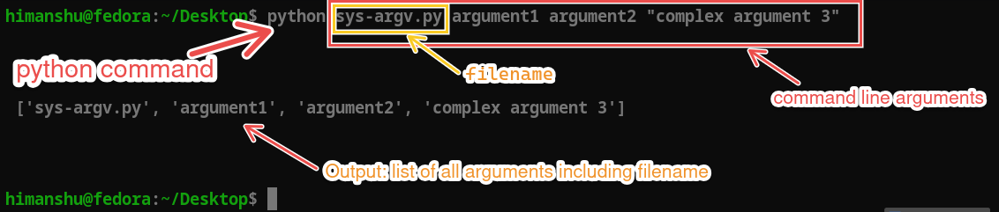

# Pyhtml and System Integration

In this section, we will briefly cover two small but practical topics:

- accessing command-line input using the `sys` module, and
- generating simple HTML output using the `pyhtml` library.

## Sys Module

The `sys` module in Python provides access to some variables used or maintained by the interpreter and to functions that interact strongly with the interpreter. We will only cover a few important aspects of the `sys` module here (more in [Week 0: sys module](../week0/0-sys.md)).

- `sys.argv`: A list of command-line arguments passed to a Python file. The first element is the name of the file, exactly as it was typed on the command line.
- `sys.exit([arg])`: Exit from Python by raising `SystemExit`. This function can take an optional argument to specify the exit status.
- `sys.version`: A string containing the version of the Python interpreter. Use the tuple `sys.version_info` (e.g. `sys.version_info >= (3, 10)`) to compare versions.
- `sys.platform`: A string that identifies the platform on which Python is running (`linux`, `win32` or `darwin`).

### sys.argv

The `sys.argv` list contains the command-line arguments passed to the file. The first element, `sys.argv[0]`, is the name of the file itself, as we typed it. The subsequent elements are the arguments passed to the file.

Here is an example of how to use `sys.argv` to print the file name and its arguments:

```python
import sys
print("file name:", sys.argv[0])
```

If you run the file with arguments like this:

```bash
python myfile.py arg1 arg2
```

The output will be:

```txt
file name: myfile.py
```

We can also print the entire `sys.argv` list:

```python
import sys
print(sys.argv)
```

If you run the file with arguments like this:

```bash
python myfile.py argument1 argument2 "complex argument 3"
```

The output will be:

```txt
['myfile.py', 'argument1', 'argument2', 'complex argument 3']
```

See the image below for a visual representation of `sys.argv` for the above command:



> [!NOTE]
>
> - The first element of `sys.argv` is the file name as typed (`python sub/myfile.py` gives `sub/myfile.py`).
> - If no arguments are passed, `sys.argv` will contain only one element, the file name.
> - Every element is a string (`str`), even if we type a number: convert it with `int()` or `float()`.
> - Arguments are space-separated strings but we can enclose them in quotes to include spaces in arguments or name of the file. This splitting is done by the **shell**, not by Python.

## Pyhtml Library

The `pyhtml` library is a simple and lightweight library for generating HTML in Python. It allows you to create HTML elements using Python syntax. Pyhtml uses functions to represent HTML tags.

### Installation

To install the `pyhtml` library, you can use pip:

```bash
pip install pyhtml
```

### Basic Usage

Here is a simple example of how to use the `pyhtml` library to create an HTML document:

```python
from pyhtml import html, head, title, body, h1, p
doc = html(
    head(
        title("My First Pyhtml Page")
    ),
    body(
        h1("Hello, Pyhtml!"),
        p("This is a paragraph generated using the pyhtml library.")
    )
)
print(doc)
```

This will generate the following HTML output (`html` also adds the `<!DOCTYPE html>` line, and every piece of text is placed on its own indented line):

```html
<!DOCTYPE html>
<html>
  <head>
    <title>
      My First Pyhtml Page
    </title>
  </head>
  <body>
    <h1>
      Hello, Pyhtml!
    </h1>
    <p>
      This is a paragraph generated using the pyhtml library.
    </p>
  </body>
</html>
```

Here we used the `html`, `head`, `body`, `h1`, and `p` functions from the `pyhtml` library to create an HTML document structure. The base element is `html`, which contains the `head` and `body` elements. Inside the `head`, we added a `title`, and inside the `body`, we added a heading (`h1`) and a paragraph (`p`). We can follow this structure to create more complex HTML documents.

> [!NOTE]
> `pyhtml` **escapes** the text we give it: `p("<b>x</b>")` is rendered as `&lt;b&gt;x&lt;/b&gt;`, so user text cannot inject HTML. Pass `_safe=True` (e.g. `p("<b>x</b>", _safe=True)`) only for text we trust.

### Creating Nested HTML Structures using Pyhtml

You can create more complex HTML structures by nesting elements. Here is an example:

```python
from pyhtml import html, head, title, body, h1, p, ul, li
doc = html(
    head(
        title("My Complex Pyhtml Page")
    ),
    body(
        h1("Welcome to My Page"),
        p("Here is a list of my favorite fruits:"),
        ul(
            li("Apple"),
            li("Banana"),
            li("Cherry")
        )
    )
)
print(doc)
```

This will generate the following HTML output:

```html
<!DOCTYPE html>
<html>
  <head>
    <title>
      My Complex Pyhtml Page
    </title>
  </head>
  <body>
    <h1>
      Welcome to My Page
    </h1>
    <p>
      Here is a list of my favorite fruits:
    </p>
    <ul>
      <li>
        Apple
      </li>
      <li>
        Banana
      </li>
      <li>
        Cherry
      </li>
    </ul>
  </body>
</html>
```

<details>
<summary><b>Try it yourself!</b></summary>

```python
from pyhtml import html, head, title, body, h1, p, ul, li
doc = html(
    head(
        title("My first Pyhtml Page")
    ),
    body(
        h1("Welcome to My Page"),
        p("Here is a list of my favourite cars"),
        ul(
            li("BMW"),
            li("Audi"),
            li("Mercedes")
        )
    )
)
print(doc)
```

</details>

## Attribute Handling in Pyhtml

In `pyhtml`, you can also add attributes to HTML elements. To add attributes, you pass them as keyword arguments in a **first call** of the tag function, and the content (children) in a **second call**: `tag(attributes)(children)`. A tag can take either children or attributes in one call, not both: `h1("Hello", style="color: blue;")` raises an `AssertionError`. These attributes need not be valid attributes in html, we can provide any key-value pair and pyhtml will create an attribute out of that pair. For example:

```python
from pyhtml import html, head, title, body, h1, p
doc = html(
    head(
        title("My Pyhtml Page with Attributes")
    ),
    body(
        h1(style="color: blue;")("Hello, Pyhtml!"),
        p(class_="my-paragraph", gender="female")("This is a paragraph with a class and a custom attribute.")
    )
)
print(doc)
```

This will generate the following HTML output:

```html
<!DOCTYPE html>
<html>
  <head>
    <title>
      My Pyhtml Page with Attributes
    </title>
  </head>
  <body>
    <h1 style="color: blue;">
      Hello, Pyhtml!
    </h1>
    <p class="my-paragraph" gender="female">
      This is a paragraph with a class and a custom attribute.
    </p>
  </body>
</html>
```

Here we added a `style` attribute to the `h1` element and `class` and a custom `gender` attribute to the `p` element. Note that since `class` is a reserved keyword in Python, we used `class_` instead. Underscores in other names become hyphens (`data_value="x"` gives `data-value="x"`), and attributes are written in alphabetical order.

### Comparison between pyhtml and jinja2

| Feature               | pyhtml                                      | jinja2                                    |
|-----------------------|---------------------------------------------|-------------------------------------------|
| Syntax                | Python function calls                       | Template syntax with delimiters           |
| Learning Curve        | Easier for Python developers                | Requires learning template syntax         |
| Use Case              | Simple HTML generation                      | Complex templating with logic             |
| Integration           | Standalone HTML generation                  | Integrates with web frameworks like Flask |
| Flexibility           | Limited to HTML generation                  | Highly flexible with control structures   |
| HTML escaping         | Always on (unless `_safe=True`)             | Off in a plain `Template`; on in Flask for HTML templates |
| Community Support     | Smaller community                           | Large and active community                 |
| Documentation         | Basic documentation available               | Extensive documentation and tutorials     |
| Popularity            | Less popular                               | Widely used in web development             |
| Use in Web Frameworks | Less commonly used                          | Commonly used in frameworks like Flask |

## Summary

In this section, we explored the `sys` module in Python, focusing on `sys.argv` for command-line argument handling. We also introduced the `pyhtml` library for generating HTML using Python syntax, demonstrating its basic usage and how to create nested HTML structures. Finally, we compared `pyhtml` with the popular templating engine `jinja2`, highlighting their differences in syntax, use cases, and community support.

### Check the following links for more details

- [sys module documentation](https://docs.python.org/3/library/sys.html)
- [pyhtml documentation](https://pypi.org/project/pyhtml/)
- [jinja2](3-4-jinja2.md)
