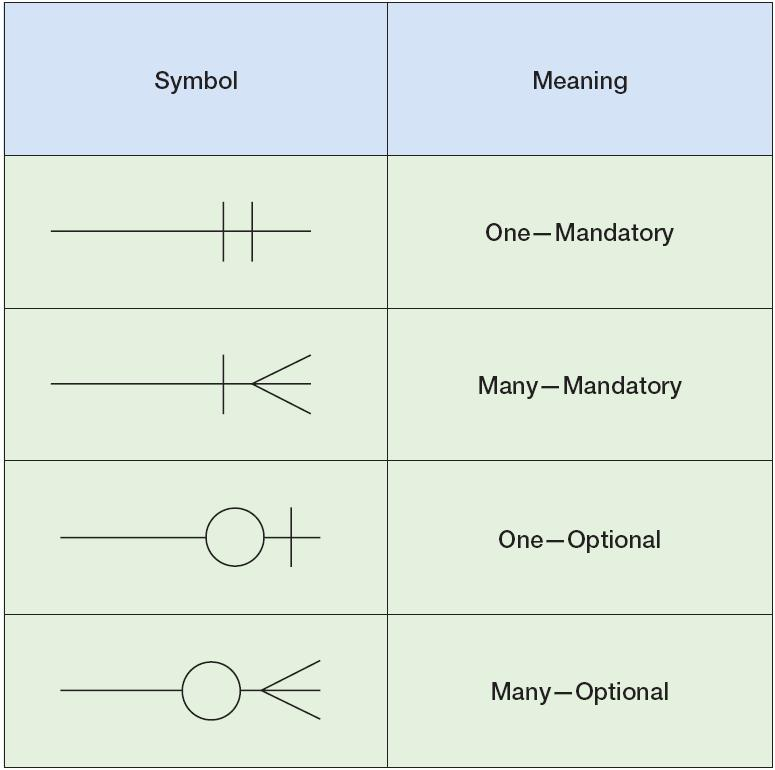

> [!TIP]
> **A small recap** for those who want to revise SQL queries (Details of these concepts are covered in DBMS course)

## Database Example: **Library Management System**

A college library built a database to keep track of:
##### `Students`

| student_id | name  | dept |
| ---------- | ----- | ---- |
| S101       | Aditi | CS   |
| S102       | Rohan | EE   |
| S103       | Meera | CS   |


##### `Books`
| book_id | title            | category | edition | publisher       |
| ------- | ---------------- | -------- | ------- | --------------- |
| B1      | Database Systems | CS       | 3rd     | Pearson         |
| B2      | Calculus         | Math     | 2nd     | McGraw Hill     |
| B3      | Physics Basics   | Physics  | 1st     | Cambridge Press |


##### `BorrowedBooks` (Many-to-Many)

| student_id | book_id | borrow_date |
| ---------- | ------- | ----------- |
| S101       | B1      | 2024-01-10  |
| S101       | B2      | 2024-01-15  |
| S102       | B3      | 2024-01-12  |
| S103       | B1      | 2024-01-18  |


This design shows a **many-to-many relationship**:

* A student can borrow multiple books.
* A book can be borrowed by multiple students (over course of time but one at a time).

## ER diagrams


> [!TIP]
> **crow feet ER diagram** (this is different from the ER symbols you learn in DBMS course⚠️ don't confuse the two conventions)
>
> The symbol at the end of a line says how many instances of that entity can take part:
>
> - Vertical line `|` → **One**<br>Ex. *A borrow record must be linked to exactly one student* (a bar next to a bar, `||`, means *exactly one*)
> - Circle `O` → **Zero** (the relationship is optional)<br>Ex. *A student may have borrowed no books at all.*
> - Crow's feet → **Many**<br>Ex. *A student can borrow many books.*
> - Symbols combine: `|O` zero or one, `||` exactly one, `|<` (bar + crow's foot) one or many, `O<` (circle + crow's foot) zero or many.

## Case 1: Create Table (Datatypes + Constraints)
```sql
CREATE TABLE Students (
  student_id CHAR(4) PRIMARY KEY,
  name VARCHAR(20) NOT NULL,
  dept VARCHAR(5)
);
```

👉🏻 `CREATE TABLE` defines a new relation with specified columns, datatypes, and integrity constraints.

## Case 2: Insert Data

```sql
INSERT INTO Students
VALUES ('S104', 'Kunal', 'ME');
```

👉🏻 Adds a new student (tuple/row) to the table

## Case 3: Simple SELECT + WHERE

### ❓ Find all CS students

**SQL**

```sql
SELECT name
FROM Students
WHERE dept = 'CS';
-- WHERE dept IN ('CS', 'EE'); for >1 departments
```

**Output**

```txt
Aditi
Meera
```

👉🏻 `SELECT` retrieves data from a table, and WHERE filters rows before they are returned.


## Case 4: JOIN (Who borrowed which book?)

**SQL**

```sql
SELECT s.name, b.title
FROM Students s
JOIN BorrowedBooks bb
  ON s.student_id = bb.student_id
JOIN Books b
  ON b.book_id = bb.book_id;
```

**Output**

```txt
Aditi   Database Systems
Aditi   Calculus
Rohan   Physics Basics
Meera   Database Systems
```

(Without an `ORDER BY` the order of the rows is not guaranteed, only the set of rows is.)

👉🏻 `JOIN` combines rows from multiple tables using a related attribute, avoiding a Cartesian product.

## Case 5: Condition with JOIN

### ❓ Find students who borrowed **Database Systems**

**SQL**

```sql
SELECT s.name
FROM Students s
JOIN BorrowedBooks bb
  ON s.student_id = bb.student_id
JOIN Books b
  ON b.book_id = bb.book_id
WHERE b.title = 'Database Systems';
```

**Output**

```txt
Aditi
Meera
```

👉🏻 `WHERE` can also be used with joined tables to filter results based on a condition.

## Case 6: Aggregation (COUNT + GROUP BY + HAVING)

### ❓ How many books has each student borrowed?

**SQL**

```sql
SELECT student_id, COUNT(*) AS books_borrowed
FROM BorrowedBooks
GROUP BY student_id
ORDER BY books_borrowed DESC, student_id;
```

**Output**

```txt
S101   2
S102   1
S103   1
```

👉🏻 `GROUP BY` groups rows with the same value, aggregate functions COUNT compute a result per group.<br>
👉🏻 `ORDER BY` sorts the final output (here by the count, highest first, then by `student_id`). It must come **after** `GROUP BY` in the same statement: the `;` ends a query, and `ORDER BY` can only use columns that exist in the result or in the tables of the query (`BorrowedBooks` has no `name` column).

To show names, join `Students` and sort alphabetically:

```sql
SELECT s.name, COUNT(*) AS books_borrowed
FROM BorrowedBooks bb
JOIN Students s
  ON s.student_id = bb.student_id
GROUP BY s.student_id, s.name
ORDER BY s.name ASC;
```

```txt
Aditi   2
Meera   1
Rohan   1
```

### ❓ Students who borrowed **more than 1 book**

**SQL**

```sql
SELECT student_id, COUNT(*) AS books_borrowed
FROM BorrowedBooks
GROUP BY student_id
HAVING COUNT(*) > 1;
```

**Output**

```txt
S101   2
```

👉🏻 `HAVING` filters groups after aggregation, while WHERE filters rows before grouping.

### DELETE

```sql
DELETE FROM BorrowedBooks
WHERE student_id = 'S102';
```
👉🏻 `DELETE` removes selected rows from a table while keeping the table structure intact.
