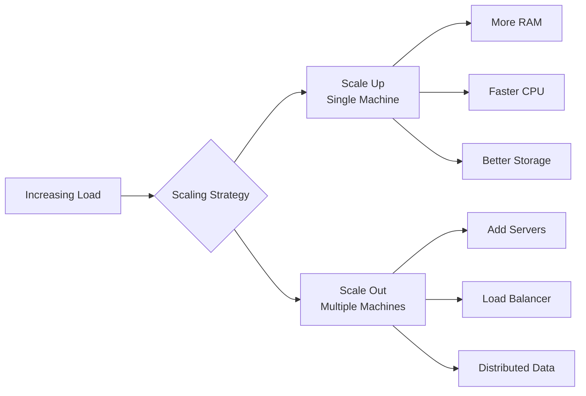
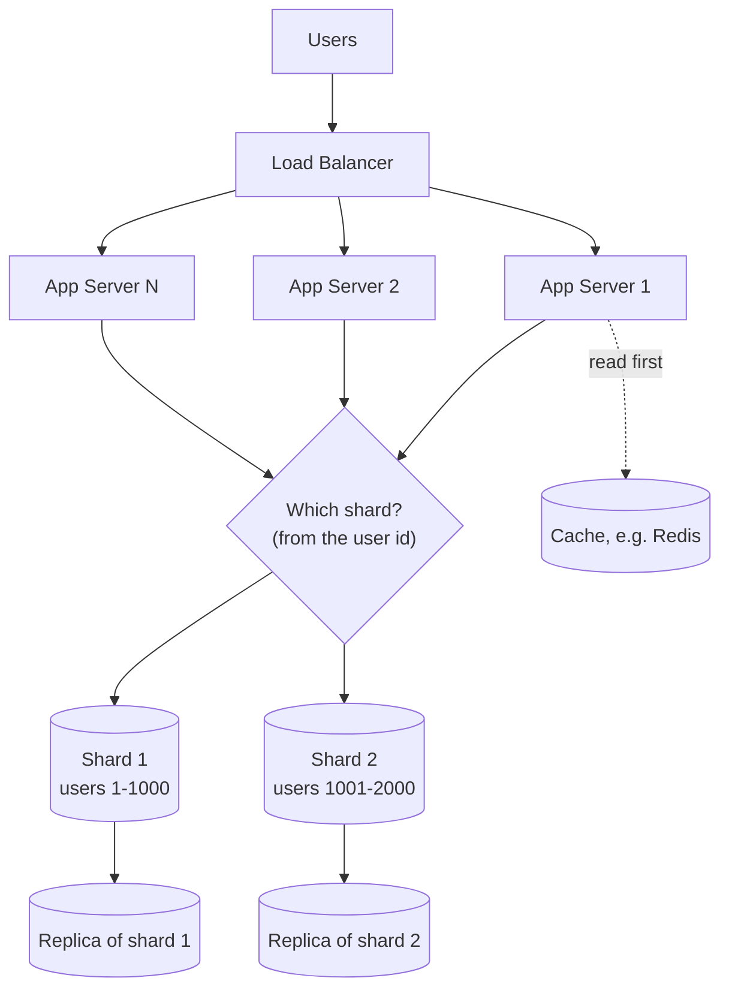
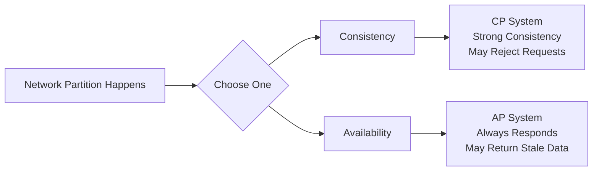

# Databases at Scale: Indexes, NoSQL and Scaling

A small app can keep its data in one SQLite file and never think about it. When the data and the number of users grow, three questions appear:

1. **How do we find a row quickly in a table with millions of rows?** → [indexes](#indexing)
2. **What if the data does not fit a table of identical rows?** → [NoSQL databases](#nosql)
3. **What if one machine is not enough?** → [scaling out, the CAP theorem and consistency](#scale-up-vs-scale-out)

(The basics of tables, SQL and the first look at NoSQL are in [Week 4: the data layer](../week4/4-1-database-layer-MODEL.md); using SQL from Flask is in [Week 5](../week5/week5-index.md); the dangers of building SQL from user input are in [web security](7-web-security.md).)

> [!NOTE]
> The SQL examples with query plans, the Redis and MongoDB commands and the small simulations on this page were run for real (SQLite, `fakeredis`, `mongomock`, Python) in [`verify_week7_claims.py`](verify_week7_claims.py). Examples in other query languages (Cypher, CQL, InfluxQL) are standard syntax that was not executed here.

## Tabular (relational) databases

- Data is stored in **structured tables**: every **row** is one record, every **column** one attribute, and **all rows of a table have the same columns**.
- Examples: MySQL, PostgreSQL, SQLite.
- They give the **ACID** guarantees (Atomicity, Consistency, Isolation, Durability, explained [below](#consistency-models-acid-and-base)).
- They support powerful queries (`JOIN`, `GROUP BY`) and, because the structure is known in advance, **efficient indexing** and efficient storage.

**The limit of "every row has the same columns".** In a college, a hostel student needs a *mess* and a day scholar needs a *gate pass for the vehicle*. In one `students` table both columns must exist and each row leaves one of them empty:

| student | hostel | mess | gate_pass |
| --- | --- | --- | --- |
| Asha | yes | Mess-2 | *NULL* |
| Ravi | no | *NULL* | GP-17 |

With many kinds of records this wastes space and becomes clumsy, which is one reason for the alternatives in the [NoSQL section](#nosql).

## Indexing

A table with $N$ rows searched for `name = 'Yash5'` without help must look at **every** row: $O(N)$. An **index** is like the index at the back of a book: a separate, **sorted (or hashed) copy of one or more columns**, with pointers to the rows, so the database can jump to the right place instead of reading everything.

```sql
CREATE INDEX idx_name ON users(name);
```

We built a `users` table with **200,000 rows** in SQLite and asked for the plan of the same query before and after creating the index (`EXPLAIN QUERY PLAN`; MySQL and PostgreSQL use `EXPLAIN`):

| Query | Plan without index | Plan with the index |
| --- | --- | --- |
| `SELECT * FROM users WHERE name = 'Yash5'` | `SCAN users` (reads all 200,000 rows) | `SEARCH users USING INDEX idx_name (name=?)` |

The same query took about **7.6 ms** with the scan and about **0.02 ms** with the index, roughly **400 times faster** on our machine.

- **Fast lookup:** an index reduces the search from $O(N)$ (full scan) to $O(\log N)$ (B-tree) or about $O(1)$ (hash index, in the ideal case without collisions). These are the structures of [data search](7-data-search-algo.md).
- **The price:** every `INSERT`, `UPDATE` or `DELETE` must also update every index, and the indexes take extra space. Inserting 100,000 rows took about **0.05 s** into a table without extra indexes and about **0.4 s** into the same table with three indexes (roughly 8 times slower).
- **Which columns?** The column must be **comparable and short**: integer, short string, date/time. **Long text fields and binary data are not good index columns.** Index the columns that you frequently search, join or sort by; **too many indexes are a waste of space and slow down writes.**

### What an index can and cannot speed up

| Query (index on the column) | Index used? | Why |
| --- | --- | --- |
| `WHERE name = 'Yash5'` | **yes** | exact match |
| `WHERE age BETWEEN 20 AND 30` | **yes** | a B-tree is sorted, so a *range* is a contiguous part of it |
| `ORDER BY age LIMIT 5` | **yes** | the rows are *already in order* in the index, no sorting step |
| `WHERE age + 1 = 31` | **no**, full scan | the column is wrapped in an expression; write `age = 30` instead |
| `WHERE name LIKE '%Yas%'` | **no**, full scan | a leading wildcard has no sorted starting point |
| `WHERE name LIKE 'Yas%'` | *depends on the database* | a **prefix** is a range (`'Yas'` to `'Yat'`) that a B-tree can use, see the box below |

<details>
<summary>LIKE with a prefix: depends on the database</summary>

`LIKE 'Yas%'` can use an ordinary B-tree index in MySQL, which the lecture slides use as the example (`LIKE 'Patrick%'` is index-friendly, `LIKE '%Patrick%'` is not). **SQLite behaves differently:** its `LIKE` ignores upper/lower case by default, which an index in the normal (binary) order cannot answer, so the plain index is **not** used. We checked the plans:

```sql
CREATE INDEX idx_name ON users(name);
SELECT * FROM users WHERE name LIKE 'Yas%';
-- SCAN users                                  (plain index is not used)
SELECT * FROM users WHERE name >= 'Yas' AND name < 'Yat';
-- SEARCH users USING INDEX idx_name (name>? AND name<?)      (the prefix written as a range)
SELECT * FROM users WHERE name GLOB 'Yas*';
-- SEARCH users USING INDEX idx_name (name>? AND name<?)      (GLOB is case-sensitive)

CREATE INDEX idx_name_nc ON users(name COLLATE NOCASE);
SELECT * FROM users WHERE name LIKE 'Yas%';
-- SEARCH users USING INDEX idx_name_nc (name>? AND name<?)   (index built for case-insensitive order)
SELECT * FROM users WHERE name LIKE '%Yas%';
-- SCAN users                                  (leading wildcard: never)
```

Lesson: **always look at the query plan** (`EXPLAIN`) instead of assuming that an index is used.

</details>

### B-tree index

<details>
<summary>How a B-tree index works</summary>

- A **balanced, multi-level tree designed for disks**: every node holds **hundreds** of sorted keys and pointers to children, so the tree is very flat. With about 100 keys per node, three levels already address $100^3 = 1{,}000{,}000$ rows and five levels more than $10^9$ rows; each level costs one disk read, so a lookup needs only a handful of reads.
- Search, insert and delete: $O(\log N)$. The data stays **sorted**.
- Supports: equality (`=`), **ranges** (`<`, `>`, `BETWEEN`), **prefix** search (`LIKE 'abc%'`, where the database allows it) and `ORDER BY` without a sort.
- Does **not** help for `LIKE '%abc'` (no sorted starting point).

```sql
-- index-friendly
SELECT * FROM users WHERE age BETWEEN 20 AND 30;
SELECT * FROM users WHERE name LIKE 'Yas%';      -- in MySQL; see the SQLite box above

-- not index-friendly
SELECT * FROM users WHERE name LIKE '%Yas%';
```

</details>

### Hash index

<details>
<summary>How a hash index works (only exact matches)</summary>

- A **hash function** maps the key to a position, as in a [hash table](7-data-search-algo.md#hash-table): very fast for `=`, average $O(1)$.
- **Cannot** do ranges (`<`, `>`), `ORDER BY`, `LIKE` patterns or prefix search, because the hash scatters the keys: *"similar keys"* are stored in unrelated places.
- Typical use: key-value lookups, `SELECT * FROM users WHERE name = 'Yashvi';`, **in-memory tables** (in MySQL hash indexes are used by in-memory tables). PostgreSQL offers `CREATE INDEX ... USING HASH`; **SQLite has no hash index** (the statement is a syntax error there).

</details>

| Feature | B-tree index | Hash index |
| --- | --- | --- |
| Exact match `=` | yes | yes (very fast) |
| Lookup cost | $O(\log N)$ | $O(1)$ on average, $O(N)$ in the worst case |
| Range queries `<`, `>`, `BETWEEN` | **yes** | no |
| `ORDER BY` without sorting | **yes** | no |
| Prefix search `LIKE 'abc%'` | yes (database dependent) | no |

### Multi-column (compound) index

An index on `(a, b, c)` is sorted by `a` first, rows with the same `a` are sorted by `b`, rows with the same `a` and `b` are sorted by `c`, like a phone book sorted by *surname, then first name*. You can find all "Sharma" quickly, or "Sharma, Anil", but **not all people called "Anil" without a surname**. This is the **leftmost prefix rule**: the index helps only when the query uses the columns **from the left, without skipping**.

| `WHERE` clause on `INDEX (a, b, c)` | Index used? | SQLite plan |
| --- | --- | --- |
| `a=1 AND b=2 AND c=3` | all three columns | `SEARCH ... (a=? AND b=? AND c=?)` |
| `a=1 AND b=2` | two columns | `SEARCH ... (a=? AND b=?)` |
| `a=1` | one column (still good) | `SEARCH ... (a=?)` |
| `a=1 AND c=3` | **only `a`**; `c` cannot be used because `b` is skipped | `SEARCH ... (a=?)` |
| `b=2` | **not used**: no starting `a` | `SCAN t` (full scan) |
| `b=2 AND c=3` | **not used** | `SCAN t` |

Notes: some engines can occasionally "skip" the first column (SQLite after `ANALYZE`, MySQL 8 skip scan), but do not rely on it. Conditions combined with `OR` on *different* columns (for example `index_part1=1 OR index_part2=10` in MySQL) usually cannot use one index and fall back to a full scan.

> [!TIP]
> **Summary:** setting up queries and indexes properly decides application performance. Compound indexes and multiple indexes are possible, but an index that no query uses is only a cost. Use the structure of the data to organise it.

## NoSQL

**NoSQL** started as an "alternative to SQL" and is now read as **"Not only SQL"**. SQL itself is just a *query language* and can be adapted to documents or graphs; what the NoSQL systems really change is **how the data is stored** and which **trade-offs** they make: a flexible structure instead of identical rows, easy distribution over many machines, and often a weaker form of consistency (see [BASE](#consistency-models-acid-and-base)) for higher scalability and availability. There are different kinds:


| Type | Data model | Good at | Weak at | Examples |
| --- | --- | --- | --- | --- |
| **Document** | JSON-like documents, each with its own fields | flexible records, reading all data of one entity at once | relations between documents, duplicated data | MongoDB, Couchbase, Amazon DocumentDB |
| **Key-value** | key → value, like a dictionary | very fast lookups by key, caches, sessions | anything except "get the value of this key" | Redis, DynamoDB, BerkeleyDB, memcached |
| **Column** | data grouped by column (or column family) | huge data sets, reading one attribute of many rows | ACID-heavy transactions | Cassandra, HBase, Bigtable |
| **Graph** | nodes and edges with properties | relationships and paths | simple tabular queries | Neo4j, Amazon Neptune, OrientDB |
| **Time series** | measurements ordered by time | monitoring, log analysis, aggregates over time | general-purpose queries | RRDtool, InfluxDB, Prometheus |

### Document databases

Free-form (typically **JSON**) documents; each document is still structured, but **has its own structure**. The hostel and day-scholar students of the example fit naturally, with no empty columns:

```json
{ "student_id": "S1", "name": "Asha", "hostel": { "block": "B", "mess": "Mess-2" } }
{ "student_id": "S2", "name": "Ravi", "day_scholar": { "vehicle_gate_pass": "GP-17" } }
```

Related data can be **embedded** in the one document that is read together (the "denormalised" design), for example a user with the books borrowed:

```json
{ "user_id": "1", "name": "Baskaran",
  "books": [ { "book_id": "B1", "title": "DBMS" }, { "book_id": "B2", "title": "Python" } ] }
```


```js
db.users.find({ user_id: "1" })                 // MongoDB: the whole document of user 1
db.users.find({ "books.title": "DBMS" })        // all users that borrowed a book titled DBMS
```

- **Strengths:** no `JOIN` needed for data stored together, fast reads of "everything about this user", each document can have a different shape (two documents with different fields live in the same collection).
- **Weakness: duplicated data.** The book title `DBMS` is stored inside the document of *every* user who borrowed it, so changing the title means updating many documents. A relational design stores it once (see [below](#the-same-scenario-in-sql)).

### Key-value stores

The simplest model: a **dictionary** that maps a **key** to a **value**. Implemented with hash tables ($O(1)$ lookup) or, in some systems, search trees (which also allow range queries on the keys). Often used **next to** another database as a fast in-memory layer.

```text
SET user:1 '{"name": "Puneet", "books": ["B1", "B2"]}'
GET user:1
SET session:9 "x" EX 30          # the key expires after 30 seconds
```

- **In-memory and extremely fast**; ideal for **caching** and session data.
- You always access the data **through the key**: the value is opaque, so "which users borrowed B1?" cannot be asked. (Real systems add more: Redis has hashes and sets, DynamoDB has secondary indexes, but the basic model stays key to value.) No relations between entries and not good for range queries.

### Column stores

"Column store" is used for two related ideas:

1. **Column-oriented storage (the course definition).** A traditional relational database stores all values of a **row** together on disk, which makes fetching one whole record very fast. A column store instead stores all values of one **column** together:

   ```text
   row store:     [U101, B1, 2026-03-01] [U101, B2, 2026-03-10] ...
   column store:  user_id [U101, U101, ...]   book_id [B1, B2, ...]   borrow_date [2026-03-01, 2026-03-10, ...]
   ```

   Reading *one attribute of all rows* ("the average age") touches only that one column: very fast. Fetching a whole row is slower. Good for analytics.
2. **Wide-column stores** (Cassandra, HBase, Bigtable): each row is identified by a **key** and holds a set of columns grouped in **column families**; **different rows can have different columns**, and data is stored sorted and spread over many servers, so they scale to very large data sets. They are not meant for ACID-heavy work.

| user_id (key) | book_id | borrow_date |
| --- | --- | --- |
| U101 | B1 | 2026-03-01 |
| U101 | B2 | 2026-03-10 |

```sql
-- CQL (Cassandra Query Language) looks like SQL; the lookup is by the key
SELECT book_id, borrow_date FROM borrow_history WHERE user_id = 'U101';
```


### Graph databases

For data in which the **relationships** matter (friends of friends, followers, maps, recommendations). The data is a graph $G = (V, E)$:

- $V$: **nodes** (entities, with an id and properties)
- $E$: **edges** (relationships, with a label and properties)
- Both nodes and edges can store **key-value properties**. Edges can have a **weight** (strength of a connection).
- The **degree** of a node is the number of relationships connected to it; the **outgoing degree** counts only the edges that start there.

```text
(User: Alice) -[BORROWED]-> (Book: DBMS)
(User: Alice) -[FRIEND]->   (User: Bob)
```

```cypher
// Cypher (Neo4j): the books borrowed by Alice
MATCH (u:User {name: "Alice"})-[:BORROWED]->(b:Book)
RETURN b;
```

- Used for social networks, **path finding** (shortest path), recommendations and knowledge discovery: following connections matters more than searching one value.
- Best for relationship queries and efficient traversal; not ideal for simple tabular queries.

### Time series databases

Data that is a **metric as a function of time**: used for log analysis, performance analysis and monitoring. Typical questions: *how many hits between T1 and T2? what is the average number of requests per second? from which country did most requests come in the past 7 days?*

| time | user | books_borrowed |
| --- | --- | --- |
| 2026-03-01 | U101 | 1 |
| 2026-03-02 | U101 | 2 |

```sql
-- InfluxQL (InfluxDB)
SELECT MEAN(books_borrowed) FROM library_usage WHERE time > now() - 7d;
```

- Efficient for monitoring, fast aggregation over time, **downsampling** (keeping hourly averages of old minute-by-minute data).
- Not a general-purpose database. Examples: RRDtool, InfluxDB, Prometheus. (Elasticsearch, a search engine often used for logs, and Grafana, a dashboard tool that draws charts from such databases, belong to the same ecosystem but are not time-series databases themselves.)

### The same scenario in SQL

The relational model stores each fact once, in three tables, and combines them with `JOIN`:

```sql
SELECT u.name, b.title
FROM Users u
JOIN Borrow br ON u.user_id = br.user_id
JOIN Books b   ON b.book_id = br.book_id
WHERE u.user_id = '1';
```

With `Users(1 Baskaran, 2 Puneet)`, `Books(B1 DBMS, B2 Python)` and `Borrow(1-B1, 1-B2, 2-B1)` the result is `Baskaran / DBMS` and `Baskaran / Python`.

- **No data duplication** (the title `DBMS` is stored once) and **strong consistency (ACID)**.
- But the `JOIN` that combines tables can be **costly at scale**.

## Scale up vs scale out

As an application grows it must handle more users, data and requests. There are two ways:

> [!WARNING]
> **Scale up (vertical):** make **one machine more powerful**. **Scale out (horizontal):** **add more machines** and share the load.



### Scale up (vertical scaling)

Increase the capacity of a **single machine**: more RAM, faster CPU, more storage, faster network.

| Aspect | Description |
| --- | --- |
| Approach | upgrade one machine |
| Advantage | simple to implement and manage |
| Performance | improves immediately |
| Limitation | hardware limits exist |
| Risk | **single point of failure** |
| Downtime | usually needed: the machine is restarted for each change |

Ideal for **small to medium systems** and monolithic applications.

### Scale out (horizontal scaling)

Add **multiple machines** and distribute the work with load balancing and data partitioning.

| Aspect | Description |
| --- | --- |
| Approach | add more machines |
| Advantage | highly scalable and fault tolerant |
| Performance | improves with more nodes |
| Limitation | system complexity increases |
| Risk | consistency and synchronisation must be handled |
| Downtime | minimal with proper design |

Ideal for **large-scale, high-traffic systems**. It is harder to keep the data consistent over many servers, so scale-out suits NoSQL / non-ACID stores well, and it fits the **cloud** model: Google, AWS and others can scale out automatically but cannot scale a machine up automatically.

#### When to use what?

| Scenario | Recommended |
| --- | --- |
| system is simple and under capacity | scale up |
| a hardware upgrade is enough | scale up |
| the system reaches hardware limits | scale out |
| high availability is required | scale out |
| massive user traffic | scale out |

In practice systems **start with scale up** (simpler) and move to **scale out** when growth demands it.


#### Depends on the application

- **Financial transactions** cannot afford even the slightest inconsistency, so they need strong ACID guarantees; the course's rule of thumb is that this is easiest on one scaled-up machine. (Large banks do run distributed databases too, but keeping strong consistency across machines is expensive and needs careful design.)
- A typical **web application** can mix both: social networks and media accept eventual consistency; in an **e-commerce** site only the *financial part* (payments, orders) needs an ACID database.

<details>
<summary>A real scenario: load balancer, shards, replicas and cache</summary>



1. **Load balancing** spreads the incoming requests over the servers: no single server is overloaded, availability and response time improve.
2. **Sharding (horizontal partitioning)** splits the *database* by a key, so each machine holds only a part of the data:
   - by **range**: users 1-1000 go to shard 1, users 1001-2000 to shard 2 (simple, but one shard can become "hot");
   - by **hash**: `shard = user_id % number_of_shards` spreads the users evenly (ids 1, 2, 3, 4, 5, 6, 7 go to shards 1, 2, 0, 1, 2, 0, 1 with three shards);
   - it improves scalability and reduces the load per database, but **queries across shards are more complex**.
3. **Replicas** (copies of each shard) improve availability and read performance, see below.
4. **Caching** (for example Redis) keeps frequently read data **in memory**, which improves the read performance. The risk is **stale data**: if a cached value is not refreshed or expires too late (a long *TTL*, time-to-live) users see the old value.

</details>

### Replication and redundancy

**Replication** means **several copies of the same data on different servers**, usually for **performance and availability**: requests can be answered by another copy, so the load is shared and no single server is overloaded. Live replication needs careful design: a replica may show the state "at the time of the last replication" instead of the newest one (a consistency problem). If no new update arrives, all replicas finally converge to the same state: **eventual consistency**. In traditional (relational) databases replication is usually a cluster in one data centre; replicating across distant data centres is harder because of the **latency** that consistency requires.

**Redundancy** means keeping **extra copies or components so that the system survives a failure**: backup servers, duplicate hardware, extra copies of the storage, often used for **backups** (one copy remains the master). The goal is **fault tolerance**: the system keeps working if something fails.

(Both involve more than one copy. Replication is mainly about *performance and availability*, redundancy about *surviving failures*.)

## CAP theorem

**Scaling out means a distributed system**, and for distributed systems the **CAP theorem** describes a hard trade-off. The three properties are:

- **Consistency (C):** every read returns the **latest write** (all nodes show the same, most recent data).
- **Availability (A):** **every request to a working node receives a (non-error) response**, even if that answer is not the newest data.
- **Partition tolerance (P):** the system **keeps working even if the network splits** the nodes into groups that cannot talk to each other.

Network failures *do* happen, so a distributed system must tolerate partitions (P). The theorem says that **when a partition happens, the system must choose between consistency and availability**; it cannot keep both. (While the network is healthy, a system can offer both. "Pick two of three" is a simplification of this.)



| System type | Guarantees | Behaviour during a failure | Example use |
| --- | --- | --- | --- |
| **CP** | consistency + partition tolerance | may **reject requests** to keep the data correct | banking systems (ACID) |
| **AP** | availability + partition tolerance | **always answers**, but may return **stale data** | social media, feeds (BASE) |
| **CA** | consistency + availability | only possible **without partitions**, i.e. on a **single node** | traditional single-server databases |

> [!NOTE]
> The "C" of CAP (all nodes agree on the latest value) is **not** the "C" of ACID (a transaction leaves the database in a valid state, with its constraints intact).

## Consistency models: ACID and BASE

A **consistency model** defines **when and how an update becomes visible** to the different parts of a distributed system: which value a read returns after a write, and in which order updates appear on the replicas.

**An example of lag.** A write goes to the primary server and is copied to a replica a moment later:

| Time | Primary | Replica | A read from the replica returns |
| --- | --- | --- | --- |
| t = 0 | balance = 100 | balance = 100 | 100 |
| t = 1: balance set to 80 | balance = **80** | still 100 (copy not arrived) | **100** (stale) |
| t = 2: copy arrives | 80 | **80** | 80 |

*Strong consistency* would not let the read at t = 1 return the old value (it would wait or fail); *eventual consistency* accepts it, because the replica **will** catch up if no further updates arrive.

> [!TIP]
> **ACID: Atomic, Consistent, Isolated, Durable.** The core principle of *transactions* in relational databases.
>
> - **Atomicity**: a transaction either completes fully or has no effect at all (all-or-nothing)
> - **Consistency**: the database always stays in a valid state (constraints are preserved)
> - **Isolation**: concurrent transactions do not interfere with each other
> - **Durability**: once committed, data is stored permanently (even after a crash)
>
> Strong consistency, used in relational databases (MySQL, PostgreSQL, SQLite) and in critical systems such as **banking and payments**, where even a split second of inconsistent data can cause problems.

> [!WARNING]
> **BASE: Basically Available, Soft state, Eventually consistent.**
>
> - **Basically Available**: the system stays available even during failures
> - **Soft state**: the data may be temporarily inconsistent between nodes
> - **Eventually consistent**: if no new updates arrive, all replicas converge to the same value
>
> It puts the stress on **high availability and scalability** (replicas may take time to become consistent). Typical in NoSQL systems (Cassandra, and others) and suitable for social media, analytics and caches, and the non-financial parts of e-commerce.

**Why give up ACID?** Consistency is hard to meet when the system is spread over many machines; eventual consistency is much easier to meet. Example: A (in India) and B (in the US) both add C as a friend on a social network. The *order* does not matter, and C appearing in A's list a moment before it appears in B's list is not a catastrophe. A **financial transaction** is different: it needs ACID.

Many NoSQL databases sacrifice some part of ACID for performance, **but ACID-compliant NoSQL databases exist** too (several document databases now offer multi-document transactions), and the "NoSQL = BASE" rule is only a first approximation.

> [!NOTE]
> **Check the following links for more details:**
>
> - [NoSQL: choices of data stores](https://www.ml4devs.com/en/articles/datastore-choices-sql-vs-nosql-database/)
> - [Screencasts: intro to FTS](https://www.youtube.com/watch?v=9NQUZgU2mMA&list=PLOXyVgDYMn7exXum694qtcRv7K4joLsH0&index=17)
>
> **Query optimisation:**
>
> - [Postgres](https://www.postgresql.org/docs/current/geqo.html)
> - [MySQL: B-tree and hash indexes](https://dev.mysql.com/doc/refman/8.0/en/index-btree-hash.html)
> - [SQLite query optimiser overview](https://www.sqlite.org/optoverview.html)
