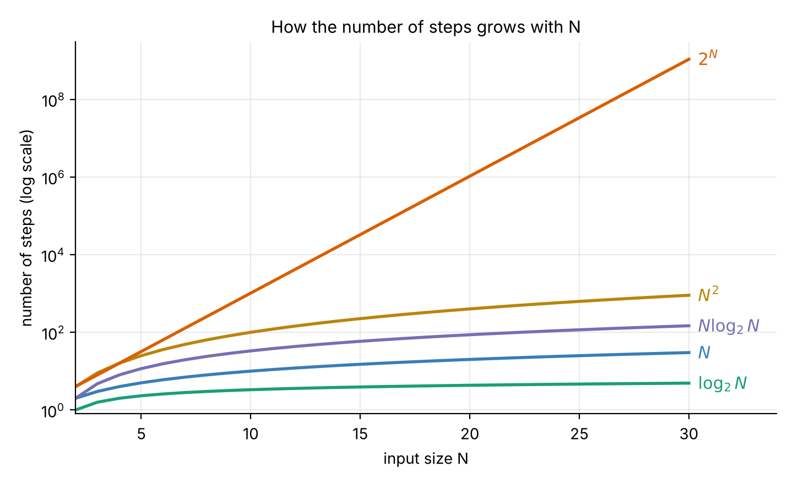
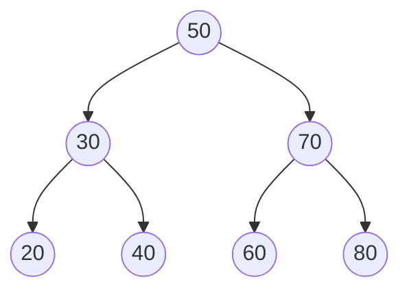

# Data search

When an application has a million users, "find the user with this id" must not mean "look at all one million of them". How fast we can **search** depends on **how the data is stored**. This page compares the common ways: a plain list, a sorted list, a tree and a hash table, and uses **Big-O notation** to describe how much slower each one gets when the data grows.

> [!NOTE]
> Every number on this page (step counts, tree heights, timings) was measured with the Python code in [`verify_week7_claims.py`](verify_week7_claims.py). Timings depend on the machine; the *ratios* and the *step counts* do not.

## Big-O notation

`O()` describes **how the number of steps (or the memory) grows when the input size $N$ grows**. It is a rough "order of magnitude", not an exact count:

- **Constants and smaller terms are dropped:** an algorithm that needs $3N^2 + 5N + 2$ steps is simply $O(N^2)$, because for a large $N$ the $N^2$ part dominates.
- Big-O is an **upper bound on the growth**. It is most often quoted for the **worst case** (for example "the element is at the very end, or not there"), but best, average and worst case of the same algorithm can have different Big-O values (a hash table lookup is $O(1)$ on average and $O(N)$ in the worst case).
- It does **not** say how many *milliseconds* something takes, only how the cost *scales*.

| $N$ | $\log_2 N$ | $N$ | $N \log_2 N$ | $N^2$ | $N^3$ | $2^N$ |
| --- | --- | --- | --- | --- | --- | --- |
| 1 | 0 | 1 | 0 | 1 | 1 | 2 |
| 2 | 1 | 2 | 2 | 4 | 8 | 4 |
| 4 | 2 | 4 | 8 | 16 | 64 | 16 |
| 8 | 3 | 8 | 24 | 64 | 512 | 256 |
| 16 | 4 | 16 | 64 | 256 | 4,096 | 65,536 |
| 32 | 5 | 32 | 160 | 1,024 | 32,768 | 4,294,967,296 |
| 64 | 6 | 64 | 384 | 4,096 | 262,144 | 18,446,744,073,709,551,616 |



*Read the picture from bottom to top: $\log_2 N$ is almost flat, $N$ grows steadily, $N^2$ already needs hundreds of steps for $N = 30$, and $2^N$ needs more than a billion.*

<details>
<summary>O(1): constant time, independent of the input size</summary>

The cost does not depend on $N$. It is excellent, but it usually needs the right data structure.

- Access the $i$-th element of an array / list: `a[i]` (the position is computed from the start address, nothing is traversed).
- Look up a key in a **hash table** (a Python `dict` or `set`): `d["alice"]` (on average, see [Hash table](#hash-table) for the collision case).
- Add an element **at the end** of a dynamic array (`list.append`) is $O(1)$ *amortised*: most appends are free, and a rare append has to copy the whole array into a bigger one (see [Arrays](#arrays)). For a linked list it is $O(1)$ only if we keep a pointer to the last node.

</details>

<details>
<summary>O(log N): logarithmic, grows very slowly (very good)</summary>

Every step **halves** the remaining work, so doubling $N$ adds only **one** step.

- **Binary search** in a sorted array: look at the middle element; if the target is *smaller* continue in the lower half, if it is *larger* continue in the upper half. Searching $1{,}000{,}000$ sorted elements needs at most **20** steps ($\log_2 10^6 \approx 19.93$, so $\lfloor \log_2 N \rfloor + 1 = 20$); $10^9$ elements need only **30**, and $2{,}000{,}000$ need 21.
- Search, insert and delete in a **balanced** search tree (AVL, red-black, B-tree).

</details>

<details>
<summary>O(N): linear, the baseline</summary>

The work grows in direct proportion to the data: in the worst case every element is looked at once.

- Search in an **unsorted** array or linked list: start at the beginning, compare each element, stop when found (or return "not found" at the end). For $10^6$ elements that is up to $1{,}000{,}000$ comparisons.
- Finding the maximum or minimum of an unsorted list.

</details>

<details>
<summary>O(N log N): "almost linear", the cost of good sorting</summary>

Efficient comparison sorts (merge sort, and Python's built-in `sorted()` / `list.sort()`) need $O(N \log N)$ steps. Sorting a million items is therefore only about 20 times more work than reading them once.

</details>

<details>
<summary>O(N^k): polynomial, e.g. N squared or N cubed (not good for large N)</summary>

- $O(N^2)$: two nested loops over the same data.

  ```python
  for i in users:        # N times
      for j in users:    # N times for every i  -> N * N steps
          ...
  ```

  Bubble sort, selection sort and insertion sort are $O(N^2)$ in the worst case ([more on sorting](https://pdsaiitm.github.io/week-2/week-2.html#Sorting-Algorithms)).
- $O(N^3)$: three nested loops, e.g. the **naive multiplication of two $N \times N$ matrices**: $N$ rows × $N$ columns × $N$ products to add up. It needs $10^3$, $20^3 = 8{,}000$ and $40^3 = 64{,}000$ multiplications for $N = 10, 20, 40$: doubling $N$ makes the work **8 times** bigger.
- Acceptable for small inputs, painful for large ones.

</details>

<details>
<summary>O(k^N): exponential, only for very small N</summary>

Every extra input element **multiplies** the work (for $k = 2$ it doubles it), so it is hopeless beyond $N \approx 30$ or so.

- Generating **all subsets** of $N$ elements: $2^N$ of them ($2^{10} = 1{,}024$, $2^{16} = 65{,}536$).
- **Recursive Fibonacci without memoisation**: `fib(n)` calls `fib(n-1)` and `fib(n-2)`, so the number of calls grows by a factor of about $1.618$ for every +1 in $n$ (`fib(10)` makes 177 calls, `fib(20)` 21,891, `fib(25)` 242,785). With memoisation (`functools.lru_cache`) `fib(60)` needs only **61** calls: remembering results turns an exponential algorithm into a linear one.
- Brute-force "try every combination" recursion.

</details>

## Searching in a list or array

| Data | Method | Cost |
| --- | --- | --- |
| **Unsorted** array or linked list | compare one element after the other | $O(N)$ |
| **Sorted** array | **binary search** | $O(\log N)$ |

Binary search only works because a sorted array gives **direct access** to the middle element (`a[mid]`). On a linked list there is no such shortcut, so binary search is not used there.

```python
def binary_search(a, target):
    lo, hi = 0, len(a) - 1          # the part of the array that can still contain the target
    while lo <= hi:
        mid = (lo + hi) // 2         # middle of the remaining part
        if a[mid] == target:
            return mid               # found: return its position
        if a[mid] < target:
            lo = mid + 1             # target can only be in the upper half
        else:
            hi = mid - 1             # target can only be in the lower half
    return -1                        # nothing left: not found
```

Example with `a = [3, 8, 15, 23, 42, 57, 61, 90]` (8 elements, so at most 4 steps):

| Target | Step | `lo` | `hi` | `mid` | `a[mid]` | Decision |
| --- | --- | --- | --- | --- | --- | --- |
| **57** | 1 | 0 | 7 | 3 | 23 | 23 < 57, go **right** |
| | 2 | 4 | 7 | 5 | 57 | **found** at index 5 |
| **10** | 1 | 0 | 7 | 3 | 23 | 23 > 10, go **left** |
| | 2 | 0 | 2 | 1 | 8 | 8 < 10, go right |
| | 3 | 2 | 2 | 2 | 15 | 15 > 10, go left: nothing left, **not found** |

In real programs use the library: `bisect.bisect_left(a, x)` does a binary search on a sorted list, and `x in my_set` is a hash lookup. For one search in a list of $N = 200{,}000$ numbers we measured roughly:

| Operation | Time | Complexity |
| --- | --- | --- |
| `x in my_list` (linear scan) | about 1,000 µs | $O(N)$ |
| `bisect.bisect_left(my_list, x)` | about 0.3 µs | $O(\log N)$ |
| `x in my_set` (hash) | about 0.2 µs | $O(1)$ on average |

## Arrays

An **array** keeps its elements next to each other in memory. That is what makes `a[i]` and binary search fast, but it causes three problems:

- **The size must be known in advance** (the memory is allocated once). To add more elements than were allocated, a **new, bigger array** is created and all elements are copied. Python's `list` hides this: it is a *dynamic array* that allocates spare room, so the copying happens rarely. In CPython 3.13, appending 40 items to an empty list reallocates only 6 times (when the length reaches 1, 5, 9, 17, 25 and 33), so most appends cost nothing extra.
- **Keeping the array sorted while inserting** costs $O(N)$:
  1. find the correct position (binary search, $O(\log N)$)
  2. **shift every later element one place to the right** to make a gap ($O(N)$)
  3. write the new element into the gap

  Inserting a value at the front of a sorted list of 1,000 numbers shifts all 999 others; inserting at the end shifts none.
- **Deleting** an element: remove it, then shift all later elements one place to the left ($O(N)$).

| Operation on an array | Unsorted | Sorted |
| --- | --- | --- |
| Search | $O(N)$ | $O(\log N)$ (binary search) |
| Insert | $O(1)$ at the end (amortised) | $O(N)$ (shifting) |
| Delete | $O(N)$ | $O(N)$ (shifting) |

## Binary search tree

A **binary search tree (BST)** stores every element in a *node* with up to two children and obeys one rule everywhere:

- everything in the **left** subtree is **smaller** than the node, everything in the **right** subtree is **larger**.



**Search for 60:** compare with the root 50 (60 is larger, go right), with 70 (60 is smaller, go left), with 60 (found): **3 comparisons** instead of looking at all 7 nodes. Searching for 45 goes 50, 30, 40 and then finds no right child: not found. Reading the tree **left, node, right** (in-order) gives the sorted sequence 20, 30, 40, 50, 60, 70, 80.

- A BST **keeps the data sorted while it grows**, and **no shifting is needed** for insert and delete: a new element is simply attached as a new leaf at the right place.
- A **balanced** tree with $N$ nodes has a height of about $\log_2 N$, so search, insert and delete are $O(\log N)$ (**average case**).
- **Worst case $O(N)$:** if the keys arrive already sorted (1, 2, 3, ...) every new key goes to the right and the tree degenerates into a linked list. We built both trees with 1,000 keys: inserted in sorted order the height was **1,000**, inserted in random order it was only about 20 ($\log_2 1000 \approx 10$; a random tree is a bit taller than the perfect one).

### Self-balancing trees

To avoid the skewed case, special trees **repair their shape** after an insert or delete (by *rotations*), so that $O(\log N)$ is **guaranteed** for search, insert and delete:

| Tree | Idea | Used in |
| --- | --- | --- |
| **AVL tree** | the heights of the left and right subtree of every node differ by at most 1 | in-memory ordered maps |
| **Red-black tree** | looser balance rule, so fewer rotations | many standard libraries |
| **B-tree** | every node holds **many keys and children** (hundreds), so the tree is very flat and each node fits one disk block | **databases and file systems** (see [indexes](7-SQL-web.md#indexing)) |

## Hash table

A **hash table** does not search at all: a **hash function** turns the key into a number, and the number (modulo the table size) is the **index** where the element is stored.

```text
table of size 8:   index = hash(key) mod 8        key 10 -> index 2     key 13 -> index 5
```

- **Lookup, insert and delete are $O(1)$ on average**, whatever the size of the data: "compute the index, go there".
- **Collisions:** two different keys can get the same index (with size 8, the keys 10 and 18 both give 2). Then the table must resolve the clash, for example by keeping a short list in every slot (*chaining*) or by trying the next free slot (*open addressing*). With a good hash function collisions are rare and the lists are tiny. In the **worst case** (all keys collide) every lookup degenerates to a scan, $O(N)$. We tested this by giving 500, 1,000 and 2,000 keys the same hash value: the lookups became hundreds of times slower than with normal hashing (about 280, 590 and 980 times on our machine), and the gap kept growing with $N$.
- **No ordering, no range queries:** the keys are scattered by the hash, so "all keys between 20 and 30" or "the smallest key" needs a full scan. (A Python `dict` remembers the *insertion* order, which is not the same as *sorted* order.)
- Ideal for **exact-match, key-value** access: Python `dict` and `set`, caches, database hash indexes.

## Choosing a data structure

| Structure | Search | Insert | Delete | Stays sorted? | Range query (20 ≤ key ≤ 30) |
| --- | --- | --- | --- | --- | --- |
| Unsorted array / list | $O(N)$ | $O(1)$ at the end | $O(N)$ | no | $O(N)$ |
| Sorted array | $O(\log N)$ | $O(N)$ | $O(N)$ | yes | $O(\log N + k)$ |
| Plain BST | $O(\log N)$ average, $O(N)$ worst | same | same | yes | $O(\log N + k)$ on average |
| Self-balancing tree / B-tree | $O(\log N)$ | $O(\log N)$ | $O(\log N)$ | yes | $O(\log N + k)$ |
| Hash table | $O(1)$ average, $O(N)$ worst | $O(1)$ average | $O(1)$ average | no | $O(N)$ (not supported) |

($k$ is the number of results returned.)

Decide by asking: *do I need only exact matches or also ranges and sorted output? How big is the data? How often is it updated?*

## Summary table

| Complexity | Name | Growth | Example |
| --- | --- | --- | --- |
| $O(1)$ | Constant | no growth | array access `a[i]`, hash lookup |
| $O(\log N)$ | Logarithmic | very slow | binary search, balanced trees |
| $O(N)$ | Linear | proportional | linear search |
| $O(N \log N)$ | Linearithmic | slightly faster than $N^2$ | efficient sorting (`sorted()`) |
| $O(N^2)$ | Quadratic | fast | bubble sort, two nested loops |
| $O(N^3)$ | Cubic | very fast | naive matrix multiplication |
| $O(k^N)$ | Exponential | explosive | all subsets, naive recursive Fibonacci |

Rules of thumb for applications: prefer $O(1)$ (hashing) for exact lookups, use $O(\log N)$ structures (sorted data, trees, **database indexes**) for scalable systems, and avoid $O(N^2)$ and worse on large data.

## Practice questions

<details>
<summary>1. How many comparisons does binary search need at most for 1,000,000 sorted elements? For 1,000,000,000?</summary>

At most $\lfloor \log_2 N \rfloor + 1$: **20** for $10^6$ and **30** for $10^9$. A thousand times more data costs only 10 extra steps.

</details>

<details>
<summary>2. A table must answer "all orders between 1 March and 31 March". Hash table or tree?</summary>

A **tree** (sorted structure, for example the B-tree index of a database): it finds the first matching key in $O(\log N)$ and then reads the neighbours in order. A hash table scatters the keys and would have to scan everything.

</details>

<details>
<summary>3. Why can a plain BST be slow although a BST "is O(log N)"?</summary>

$O(\log N)$ holds only when the tree is reasonably balanced. If keys are inserted in sorted order, every key becomes the right child of the previous one and the tree is a linked list of height $N$ (1,000 keys gave height 1,000 in our test), so a search is $O(N)$. Self-balancing trees (AVL, red-black, B-tree) prevent this.

</details>

<details>
<summary>4. How many multiplications does the naive product of two 100 × 100 matrices need?</summary>

$N^3 = 100^3 =$ **1,000,000**. Doubling $N$ to 200 would need 8,000,000.

</details>

**Where this matters later:** a database **index** is exactly such a sorted (B-tree) or hashed structure, see [SQL, NoSQL and scaling](7-SQL-web.md#indexing); and [where the data lives in memory](7-memory-architecture.md) decides how fast each step really is.
