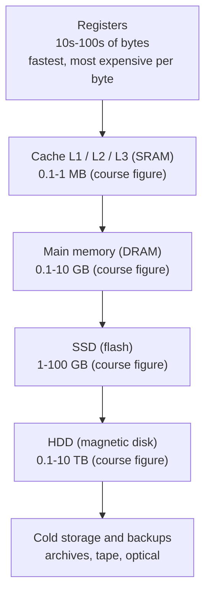

# Memory Hierarchy

A computer needs memory that is **fast**, **big** and **cheap**, but no single technology is all three: the fast memory is small and expensive, the big memory is slow. So computers combine several kinds of storage in layers, a **memory hierarchy**, and keep the data that is used most in the fastest layer.



Going **down** the hierarchy: the **latency increases** (slower to start reading), the throughput generally decreases, the **capacity increases** and the **cost per bit decreases**.

- **SRAM** = **S**tatic RAM, **DRAM** = **D**ynamic RAM. An SRAM cell is a small circuit (a flip-flop of about 6 transistors) that simply *keeps* its bit while powered: fast, but large and expensive per bit. A DRAM cell is **one transistor plus one tiny capacitor**: small and cheap, but the charge leaks away, so every cell must be **refreshed** (re-written) many times per second, which makes it slower.
- [ℹ️ Magnetic disk animation](https://youtu.be/ngP6nSt_yAE) · [ℹ️ Cores and threading](https://cdn.hashnode.com/res/hashnode/image/upload/v1605989026367/G0PyS99Px.png)

## The levels at a glance

| Level | Technology | Course figure (lecture slides) | Typical today (varies a lot) | Latency (order of magnitude) | Keeps data without power? |
| --- | --- | --- | --- | --- | --- |
| **Registers** | inside the CPU | 10s-100s of bytes | dozens of registers, about 100 bytes to a few KB | under 1 ns (about one clock cycle) | no |
| **Cache** L1, L2, L3 | SRAM | 0.1-1 MB | L1: tens of KB per core; L2: hundreds of KB to a few MB per core; L3: several to tens of MB, shared | about 1 ns (L1) up to tens of ns (L3) | no |
| **Main memory** | DRAM | 0.1-10 GB | 8-64 GB in a laptop or desktop, much more in servers | about 100 ns | no |
| **SSD** | flash | 1-100 GB | 256 GB-4 TB | about 100 µs | **yes** |
| **HDD** | magnetic disk | 0.1-10 TB | 1-20 TB | about 10 ms | **yes** |
| **Cold storage** | tape, optical, cloud archive | huge | petabytes | minutes to hours | **yes** |

The "course figure" column is the one used in the lecture slides; hardware keeps growing, so the "typical today" column is larger. The latencies are typical orders of magnitude (published by hardware vendors and used as rules of thumb), not exact values: the exact numbers depend on the machine.

**Feeling the differences.** Imagine that one cache access took **1 second**. Then reading from DRAM would take about **100 seconds** (1.7 minutes), reading from an SSD about **1.2 days** and a hard disk seek about **116 days** (almost four months). A program that waits for the disk in every step is waiting a *very* long time compared to the CPU.

## Key performance metrics

1. **Latency**: the time until the **first byte** of the requested data arrives (**lower is better**).

   `Register < SRAM < DRAM < SSD < HDD`

2. **Throughput** (bandwidth): the number of bytes that can be transferred **per second** (**higher is better**), $\dfrac{\text{bytes read}}{\text{second}}$.

   - Among the **large-capacity** storage levels: `DRAM > SSD > HDD`. Typical values: DRAM tens of GB/s, a SATA SSD about 0.5 GB/s (NVMe SSDs several GB/s), an HDD about 0.1-0.2 GB/s.
   - Registers and SRAM are even faster per second, but they are **too small** to hold the data of a large transfer, so the comparison for big data is made between DRAM, SSD and HDD.

3. **Density**: how much data fits per unit **cost or area** (**higher is better**), $\dfrac{\text{number of bits stored}}{\text{cost} \times \text{area}}$. Large-scale manufacturing matters here.

   `Registers < SRAM < DRAM < SSD < HDD` (in other words, `HDD > SSD > DRAM > SRAM > Registers`)

   Registers are the most expensive per bit, HDDs the cheapest for large storage.

> [!IMPORTANT]
> **Latency and throughput are different things.** An HDD has a bad latency (about 10 ms before the first byte) but, once it is reading a long stretch, a decent throughput. A fast link with a high latency is like a wide pipe that is far away. This is the same difference as in [latency vs bandwidth](../week1/1-2-latency-bandwidth.md) for networks.

### Estimating the memory bandwidth

The theoretical bandwidth of a memory system follows from its hardware parameters:

$$\text{Bandwidth} = \text{clock speed} \times \text{transfers per clock} \times \text{bus width (bytes)} \times \text{channels}$$

**Example (DDR3-1600, dual channel):** clock **800 MHz**, **2** transfers per clock (DDR = *double* data rate: data moves on the rising and the falling edge of the clock), a **64-bit = 8-byte** bus, **2** channels:

$$800\times10^{6} \times 2 \times 8 \times 2 = 25.6\times10^{9}\ \text{bytes/s} = 25.6\ \text{GB/s}$$

(One channel alone would give 12.8 GB/s.)

## Storage elements

### Registers

- Located **inside the CPU**; they hold the numbers an instruction is working on right now (the CPU's "notepad").
- The **fastest** memory there is, but only a few dozen of them exist: 10s-100s of bytes in the course figure.

### SRAM: cache memory (L1, L2, L3)

- Stores copies of **frequently used data and instructions** so the CPU does not have to wait for DRAM.
- L1 is the smallest and fastest (one per core), L3 the largest and slowest of the three and usually shared by all cores.
- It works because programs show **locality of reference**:
  - **Temporal locality**: data used *recently* is likely to be used *again soon* (a loop variable).
  - **Spatial locality**: data *near* the one just used is likely to be used next (the next array element). Therefore the cache never loads a single byte, it loads a whole **cache line** (typically 64 bytes).
- Very fast but expensive, so it is used only in small amounts.

### DRAM: main memory

- Holds the programs that are running and their working data.
- **Volatile**: everything is lost when the power is off.
- Much slower than the cache, but much larger: the primary working memory.

### SSD: solid-state drive (flash)

- **Non-volatile**: data survives without power.
- **No moving parts**, so the latency is far lower than for an HDD, and random reads are fast.
- High throughput; used for the operating system, applications and databases.

### HDD: magnetic disk

- Very large capacity at a low price per GB.
- **Spinning platters and a moving read/write head**: to read a block the head must first move to the right track (*seek*) and then wait until the right part of the platter passes under it (*rotational delay*). At 7,200 rpm one rotation takes $\frac{60}{7200}\text{ s} = 8.33$ ms, so the *average* wait for the right spot is half of that, **4.17 ms**, before any seek time is added. That is why one HDD access takes about 10 ms, and why **sequential** reads (no head movement) are far faster than **random** reads.

> [!WARNING]
> **Cache and locality of reference.** Frequently used data is kept in the faster levels to minimise access time. The cache reduces the **average memory access time** by serving most requests from fast memory.

## Cache in numbers: average access time

If a request is found in the cache (a **hit**) it costs the hit time; otherwise (a **miss**) the slower level must be read as well:

$$\text{average access time} = t_{\text{hit}} + \text{miss rate} \times t_{\text{miss penalty}}$$

| Hit time | Miss rate | Miss penalty | Average access time |
| --- | --- | --- | --- |
| 1 ns | 0 % | 100 ns | 1 ns |
| 1 ns | 1 % | 100 ns | $1 + 0.01 \times 100 =$ **2 ns** |
| 1 ns | 5 % | 100 ns | $1 + 0.05 \times 100 =$ **6 ns** |
| 1 ns | 100 % | 100 ns | 101 ns (the cache only adds delay) |

A 5 % miss rate already makes the system **six times slower** than a perfect cache, so keeping the miss rate low is worth a lot.

### Spatial locality that you can measure

A 2-D array is stored **row after row**. Adding up the numbers row by row reads consecutive memory (every cache line is used completely); adding up column by column jumps 32,000 bytes between two numbers (every cache line is loaded for one number only):

```python
import numpy as np

a = np.random.rand(4000, 4000)                      # 128 MB, stored row after row

def by_rows():  return sum(a[i, :].sum() for i in range(4000))   # consecutive memory
def by_cols():  return sum(a[:, j].sum() for j in range(4000))   # jumps of 32,000 bytes
```

Both functions add up exactly the same numbers. On the test machine `by_rows` took **15 ms** and `by_cols` **53 ms** (3.6 times slower); for plain Python lists of lists the difference was 13 ms against 211 ms. Your ratio will differ, but column-wise access is slower because of the cache.

## Computer organization

How the layers work together:

- the CPU computes with data in **registers**
- backed by **L1, L2, L3 cache** (SRAM)
- backed by several GB of **DRAM** as the working memory
- backed by an **SSD** for high-throughput persistent storage
- backed by an **HDD** for high capacity
- all layers are finally backed by **long-term storage and backups**

This layered design keeps frequently used data close to the CPU and avoids expensive trips to the slow levels. You can look at your own machine with `lscpu` (cache sizes) and `free -h` (DRAM) on Linux or WSL.

### Cold storage

Storage for **backups and archives**: huge amounts of data that are **rarely read** and can tolerate a **high read latency**.

- Examples: Amazon S3 Glacier, and the archive / cold storage classes of Google Cloud and Azure.
- **Very low cost** per GB and **very high durability** (the data is almost never lost), but retrieval is slow: it can take from minutes up to hours, and the slowest and cheapest options up to **48 hours** (provider documentation, not measured here). Retrieval may also be billed.
- Other media for long-term storage: magnetic tape and optical discs; holographic storage is still experimental.

## Insights for application development

The **speed of an application is determined by what data is stored where and how it is accessed**, so a developer must know the options and choose the right data store for the application.

- **Plan the storage needs** in advance, based on the expected growth of the app.
- Keep **hot** (frequently used) data in fast memory, move **cold** (rarely used) data to cheaper storage:

  | Data | Typical place | Example |
  | --- | --- | --- |
  | **Hot**: read all the time | DRAM, in an in-memory cache | Redis / memcached holding sessions or popular pages |
  | **Warm**: normal working data | SSD, in the main database | users, orders |
  | **Cold**: old, rarely read | HDD or archive storage | last year's logs, backups |

- **Design around the access pattern**: different data stores are efficient for different reads and writes (read-heavy or write-heavy, exact lookups or ranges).
- Balance **latency** (reads) and **throughput** (writes) for the workload.
- Prefer $O(1)$ lookups (hashing) when possible, $O(\log N)$ structures (trees, binary search, [database indexes](7-SQL-web.md#indexing)) for scalable systems, and avoid $O(N^2)$ and worse on large data ([data search](7-data-search-algo.md)).
- Choose the data structure by the **type of search** (exact or range), the **size** of the data and the **update frequency**.

## Practice questions

<details>
<summary>1. Cache with a hit time of 2 ns, a miss rate of 10 % and a miss penalty of 80 ns: average access time?</summary>

$2 + 0.10 \times 80 =$ **10 ns**.

</details>

<details>
<summary>2. A memory runs at a 1,000 MHz clock, DDR (2 transfers per clock), with an 8-byte bus and 2 channels. Peak bandwidth?</summary>

$1000\times10^{6} \times 2 \times 8 \times 2 = 32\times10^{9}$ bytes/s = **32 GB/s**.

</details>

<details>
<summary>3. Which levels lose their data when the power is switched off?</summary>

Registers, SRAM (cache) and DRAM are **volatile**. SSD, HDD and cold storage are non-volatile.

</details>

<details>
<summary>4. Why is reading many small random pieces from an HDD so much slower than reading one large file?</summary>

Every random piece costs a **seek** plus on average half a rotation (4.17 ms at 7,200 rpm), about 10 ms in total, while a large file is read in one stretch without moving the head, so the seek and rotation delay is paid only once.

</details>
