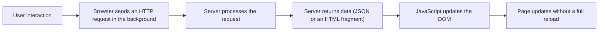

# Asynchronous Updates

In the original web model every change meant a **full page reload**. Modern pages instead update **only the part that changed**, by asking the server for just the data they need while the user keeps using the page. This is done with **asynchronous** code.

Example: a shop page has a drop-down with *clothes categories*.

1. The user picks a category.
2. JavaScript requests **only that category's data** (a small JSON response, not a whole HTML page).
3. JavaScript updates one `<div>` with the new items. The rest of the page, and the scroll position, stay untouched.

Benefits: no full-page reload, less data transferred, faster perceived speed, and pages that can react to live data.

## Blocking vs non-blocking code

JavaScript in a page runs on **one main thread**. The same thread also draws the page and handles clicks. So:

* **Blocking (synchronous)** code holds the thread until it finishes, and **nothing else can happen**: no clicks, no animations, no timers.
* **Non-blocking (asynchronous)** code *starts* a slow job (a network request, a timer) and **returns immediately**; the browser calls your code back when the job is done, and the thread stays free meanwhile.

A direct measurement in a browser: a timer ticking every 50 ms ticked about **10 times** during a 500 ms asynchronous wait, but **0 times** during a 500 ms busy loop (`while (performance.now() < end) {}`). The loop froze the page, including every timer, for the whole half second.

| | Synchronous (blocking) | Asynchronous (non-blocking) |
| - | ---------------------- | --------------------------- |
| Execution | One task at a time; the next waits for the previous one to finish | A slow task is started and the code moves on; the result arrives later |
| User experience | The page can **freeze** while waiting | The page stays responsive |
| Typical use | Short, quick computations | Network calls, timers, background updates |

**Analogy.** Synchronous: standing at the counter until your order is ready. Asynchronous: placing the order, sitting down, and being called when it is ready.

> [!NOTE]
> The usual cause of a frozen page is *your own heavy code* on the main thread, not the network. To run heavy computation without freezing the page, use a **Web Worker**: a separate thread with no access to the DOM. In a test, a worker computing a long loop left the page's timers running, and inside the worker `document` and `window` were `undefined`. (Another option is [WebAssembly](8-wasm-and-browser-security.md#webassembly-wasm), which is faster but still runs on the main thread unless you put it in a worker.)

### `fetch` is already asynchronous

The browser's `fetch(url)` starts the request and **immediately returns a Promise**, an object that stands for "a result that will exist later". Calling it without `await` does not block, and does not give you the data either:

```javascript
function fetchDataNoAwait() {
  let response = fetch("/data");     // starts the request, returns a Promise at once
  console.log("Data fetched! response is: " + Object.prototype.toString.call(response));
}
fetchDataNoAwait();                  // prints: Data fetched! response is: [object Promise]
console.log("after the call");       // runs immediately: nothing waited
```

The message "Data fetched!" is therefore misleading: nothing has been fetched yet when it prints. (A genuinely blocking network call, synchronous `XMLHttpRequest`, exists but is deprecated because it freezes the page.)

### `async` / `await`

`await` lets you write asynchronous code that **reads like normal top-to-bottom code**:

```javascript
async function fetchData() {
  try {
    console.log("Fetching data...");

    // wait for the response, but only inside this function
    const response = await fetch("https://example.com/data");

    // wait for the body to be parsed as JSON
    const data = await response.json();
    console.log("Data received:", data);
  } catch (error) {
    console.error("Error fetching data:", error);
  }
}

fetchData();

// this line runs right away: it does NOT wait for the data
console.log("This runs before data is received");
```

Output order, observed in a browser (with a server that answers after 300 ms):

```text
Fetching data...
This runs before data is received
Data received: (the parsed JSON object, shown in the browser's own format)
```

How to read it:

* `async` marks a function that can use `await` and **always returns a Promise**.
* `await` pauses **only that function**; the browser carries on with other work (here the last `console.log` of the script). When the awaited Promise is ready, the function resumes.
* Order of work in the browser: first the current code finishes; then **Promise callbacks** (`.then`, code after `await`); then **timers** (`setTimeout`). A test printed `sync`, `promise`, `timeout 0` in that order even though the timeout had a 0 ms delay.

#### Error handling: HTTP errors do not throw

`fetch` rejects its Promise only when the request **could not be made** (network down, blocked by CORS). A response such as `404 Not Found` or `500` is still a "successful" fetch, so check it yourself:

```javascript
const response = await fetch("/api/items");
if (!response.ok) {                       // ok is true only for status 200-299
  throw new Error("HTTP " + response.status);
}
const items = await response.json();
```

#### Cross-origin requests

By default a page may read responses only from its **own origin** (same scheme, host and port). Asking another origin works only if that server replies with an `Access-Control-Allow-Origin` header (**CORS**): without it the browser refuses to give your code the response and `fetch` fails with `TypeError: Failed to fetch`. Details: [Same-origin policy and CORS](8-wasm-and-browser-security.md#same-origin-policy-and-cors).

## Asynchronous communication techniques

### AJAX

**AJAX** (*Asynchronous JavaScript and XML*) means *requesting data in the background and updating part of the page*. The name is historical: modern code almost always sends **JSON** instead of XML, and uses `fetch` (older code used `XMLHttpRequest`). It follows a **request-response** model: the browser asks, the server answers once.

Use cases: loading more comments, search suggestions while typing, refreshing a dashboard.

### WebSockets

A **WebSocket** is a **persistent, two-way (full-duplex)** connection over a single TCP connection. After it is open, **either side can send at any moment**: the server does not need to be asked first.

How it starts: the browser sends an ordinary HTTP request with `Upgrade: websocket`; if the server agrees, it answers **`101 Switching Protocols`**, and the same connection now carries WebSocket messages instead of HTTP. (A test with `curl` against a WebSocket server showed exactly `HTTP/1.1 101 Switching Protocols`, `Upgrade: websocket`, `Connection: Upgrade`.)

Ideal for: chat, live notifications, online games, live prices and dashboards.

A small server in Python (`pip install websockets`) that greets each client and echoes every message:

```python
import asyncio
import websockets


async def handler(ws):
    await ws.send("welcome")                 # the server speaks first: nobody asked it to
    async for message in ws:
        await ws.send("echo:" + message)


async def main():
    async with websockets.serve(handler, "localhost", 8765):
        await asyncio.Future()               # run forever


asyncio.run(main())
```

and the browser side:

```javascript
const socket = new WebSocket("ws://localhost:8765");
socket.onmessage = (event) => console.log(event.data);
socket.onopen = () => socket.send("hi");
// received in turn: "welcome", then "echo:hi"
```

In a browser test, the client received `welcome`, then (after sending `hi` and `again`) `echo:hi` and `echo:again`.

| | AJAX / `fetch` | WebSocket |
| - | -------------- | --------- |
| Model | Request, then response | Open channel, messages both ways |
| Who starts a message? | Always the client | Client **or server** |
| Connection | Normally a new request each time | One long-lived connection |
| Good for | Occasional updates, loading data on demand | Real-time, frequent, server-initiated updates |

> [!NOTE]
> WebSockets need a server that can keep many connections open. That does not fit WSGI's one-request-one-response model; see the note at the end of [WSGI](8-wsgi.md).

### The asynchronous flow



The DOM operations in step E are explained in [DOM Manipulation](8-basic-dom-manipulation.md). A complete example that fetches data and builds the page is in [Frontend Fundamentals](8-frontend.md#seeing-the-difference).

## Other browser capabilities

### Canvas API

The `<canvas>` element is a rectangle that JavaScript can **draw on pixel by pixel**: shapes, images, charts, animations, games.

```html
<canvas id="c" width="100" height="50"></canvas>
<script>
  const ctx = document.getElementById("c").getContext("2d");
  ctx.fillStyle = "red";
  ctx.fillRect(10, 10, 30, 20);   // x, y, width, height: a red rectangle
</script>
```

Reading a pixel back confirmed the rectangle is red at (20, 20) and untouched (transparent) at (60, 20).

### Web storage

The browser can store small amounts of data **on the user's device**, per origin:

| | `localStorage` | `sessionStorage` |
| - | -------------- | ---------------- |
| Lifetime | Stays until deleted: survives closing the browser | Cleared when the tab is closed |
| Shared between tabs of the same site? | Yes | **No**: each tab has its own |

```javascript
localStorage.setItem("theme", "dark");
console.log(localStorage.getItem("theme"));      // dark (still there after a reload)

localStorage.setItem("count", 5);
console.log(typeof localStorage.getItem("count"));   // string  (values are always strings)

// to store an object, convert it
localStorage.setItem("prefs", JSON.stringify({ font: 16 }));
console.log(JSON.parse(localStorage.getItem("prefs")).font);   // 16
```

In a test: after a reload both values survived; a *new tab* of the same site saw `localStorage` (`dark`) but an empty `sessionStorage`; a *different browser profile* saw neither.

> [!WARNING]
> Web storage is readable by any script on the page and by the user. Never keep passwords or secrets in it. (Cookies, the other client-side store, and their security are in [Week 9](../week9/9-cookie.md); more on web storage comes in the MAD-2 course.)

### Drag and drop

Elements with `draggable="true"` fire `dragstart`; a drop target must cancel `dragover` (otherwise dropping is not allowed) and handle `drop`. Used for file uploads and visual editors.

```html
<div id="item" draggable="true">Drag me</div>
<div id="zone">Drop here</div>
<script>
  const item = document.getElementById("item");
  const zone = document.getElementById("zone");
  item.addEventListener("dragstart", e => e.dataTransfer.setData("text/plain", item.id));
  zone.addEventListener("dragover", e => e.preventDefault());   // required to allow the drop
  zone.addEventListener("drop", e => {
    e.preventDefault();
    zone.append(document.getElementById(e.dataTransfer.getData("text/plain")));
  });
</script>
```

Dragging `item` onto `zone` in a browser test moved it inside `zone`.

## Accessibility and best practices

**Accessibility** means the page can be used by everyone: people who use screen readers, keyboards instead of a mouse, large fonts, or who cannot see colours well. The **World Wide Web Consortium (W3C)** publishes the standards (HTML, CSS, DOM) and the **Web Content Accessibility Guidelines (WCAG)**. Practical rules:

* **Do not rely on colour alone** to convey meaning (add text or an icon next to a red error).
* Use the right HTML element (`<button>`, `<label>`, headings): browsers and screen readers understand them automatically.
* Give images alternative text (`alt`), and make everything usable with the keyboard.
* Keep **structure (HTML), style (CSS) and behaviour (JavaScript) separate**, so the user's browser can apply its own settings.
* Test in several browsers and screen sizes.

A browser needs only a few things to take part in all of this: it must **render HTML** and **handle cookies** (for sessions, see [Week 9](../week9/9-cookie.md)).

## Practice questions

<details>
<summary>1. A script contains <code>fetch("/data"); console.log("done");</code>. Which prints first, the response or "done"?</summary>

"done" prints at once. `fetch` returns a Promise immediately and the response arrives later, so nothing in this code waits for it.
</details>

<details>
<summary>2. Does <code>await</code> freeze the page while the request is in flight?</summary>

No. It pauses only the `async` function that contains it. The browser continues running other code, handling clicks and drawing the page, and resumes the function when the Promise settles.
</details>

<details>
<summary>3. The server answers a <code>fetch</code> with <code>404</code>. Does the <code>catch</code> block run?</summary>

No. `fetch` rejects only for network-level failures. A 404 is a normal response with `response.ok === false`, so you must check `response.ok` (or `response.status`) and throw yourself.
</details>

<details>
<summary>4. A live chat uses WebSockets, not AJAX polling. Why?</summary>

The server must be able to send a message **whenever someone writes**, without the client asking. A WebSocket stays open in both directions; with AJAX the client would have to keep asking ("polling"), wasting requests and adding delay.
</details>

<details>
<summary>5. Where does data in <code>sessionStorage</code> go when the tab is closed, and how is it different from <code>localStorage</code>?</summary>

It is deleted when the tab closes, and it is not shared with other tabs. `localStorage` persists across restarts and is shared by all tabs of the same origin.
</details>
