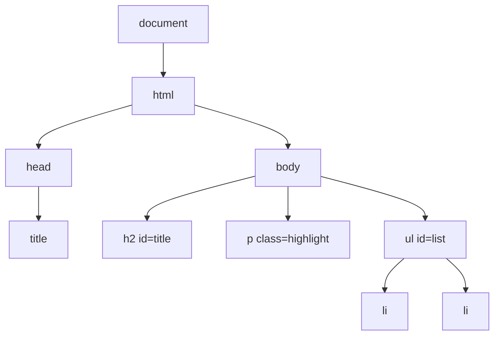

# Basic DOM Manipulation

The **Document Object Model (DOM)** is the browser's live, in-memory representation of a web page: a **tree of objects** that JavaScript can read and change. When the DOM changes, the browser updates what is on screen, with **no reload and no request to the server**. This is how every dynamic page works.



Every box is a **node**: an element (`<h2>`), a piece of text, or an attribute. Elements have a parent, children and siblings, and the browser provides methods to walk and modify the tree.

> [!NOTE]
> **The DOM is not the HTML source.** The source is the text the server sent; the DOM is what the browser built from it *plus* every later change made by JavaScript. For the client-side-rendered page of [Frontend Fundamentals](8-frontend.md#seeing-the-difference), "view source" (and `curl`) shows no fruit names, while the DOM, which you can inspect in DevTools' *Elements* tab, contains the three `<li>` elements.

## The page used in the examples

All snippets below act on this page. Try them in the browser console (`F12`) while it is open, or put them in a `<script>` at the end of `<body>`.

```html
<body>
  <h2 id="title" class="highlight">Welcome</h2>
  <p class="highlight">First paragraph</p>
  <ul id="list">
    <li>one</li>
    <li>two</li>
  </ul>
  <button id="myButton">Click me</button>
  <div id="myElement">Original text</div>
  <div id="oldElement">I will be removed</div>
</body>
```

## Selecting elements

You must first **get a reference** to an element before changing it.

| Method | Returns | When nothing matches |
| ------ | ------- | -------------------- |
| `document.getElementById("id")` | the element | `null` |
| `document.getElementsByClassName("c")` | live `HTMLCollection` | empty collection |
| `document.getElementsByTagName("p")` | live `HTMLCollection` | empty collection |
| `document.querySelector("css selector")` | the **first** match | `null` |
| `document.querySelectorAll("css selector")` | static `NodeList` | empty `NodeList` (length 0) |

```javascript
const title = document.getElementById("title");        // <h2 id="title">
const first = document.querySelector(".highlight");    // first element with class "highlight"
const all = document.querySelectorAll(".highlight");   // both of them
console.log(all.length);                               // 2
```

Notes:

* `querySelector(All)` accepts any **CSS selector** (`#id`, `.class`, `ul > li`, `input[type="email"]`), which makes it the most flexible and the most used.
* `getElementsBy…` return a **live** `HTMLCollection` (it updates by itself when the page changes), while `querySelectorAll` returns a **static** snapshot `NodeList`. In a test on the page above, after adding a third element with class `highlight`, the live collection reported 3 but the earlier `querySelectorAll` result still said 2.
* Check for `null` before using the result of `getElementById` / `querySelector`, or you will get `Cannot set properties of null`.

## Changing content

```javascript
const box = document.getElementById("myElement");
box.textContent = "This is new text";      // sets the TEXT
box.innerHTML = "<b>This is bold</b>";     // sets HTML: the <b> becomes a real element
```

| Property | Reads / writes | Notes |
| -------- | -------------- | ----- |
| `textContent` | all the text inside, as plain text | Fast; includes text of hidden elements; **safe** |
| `innerText` | the text *as displayed* | Skips hidden elements (`display:none`); forces a layout, so slower |
| `innerHTML` | the HTML markup inside, as a string | The string is **parsed as HTML** |

For `<div>old <b>bold</b> <span style="display:none">hidden</span></div>`: `innerHTML` is `old <b>bold</b> <span style="display:none">hidden</span>`, `textContent` is `old bold hidden`, and `innerText` is `old bold`. Setting `textContent = "<i>x</i>"` shows the literal characters `<i>x</i>` (no `<i>` element is created), while setting `innerHTML = "<i>x</i>"` creates a real `<i>` element.

> [!WARNING]
> **Never put user-supplied text into `innerHTML`.** The browser parses it as HTML and executes event-handler attributes. In a test, `div.innerHTML = ''` **ran the `onerror` code**; with `div.textContent = ''` nothing ran and no element was created. (A `<script>` tag inserted through `innerHTML` is not run, but handlers like `onerror` are.) This is **XSS** (cross-site scripting), covered in [Week 9](../week9/9-week-index.md). Use `textContent` for text, and `innerHTML` only for markup you wrote yourself.

## Changing attributes

```javascript
const box = document.getElementById("myElement");
box.setAttribute("class", "newClass");   // set an attribute by name
box.id = "newId";                        // or through the property of the same name
```

* After the `id` changes, `document.getElementById("myElement")` returns `null`, because the old id no longer exists.
* To add/remove a single class, do not overwrite the whole attribute. Use **`classList`**:

```javascript
const para = document.querySelector("p");
para.classList.add("big");        // adds "big", keeps other classes
para.classList.toggle("big");     // removes it again (adds if absent)
```

* `getAttribute` always returns a **string** (or `null` if absent). `setAttribute("data-x", 5)` stores `"5"`. Custom `data-*` attributes are available as `element.dataset.x`.

## Changing styles

```javascript
const box = document.getElementById("myElement");
box.style.color = "red";                 // CSS: color
box.style.backgroundColor = "yellow";    // CSS: background-color  (camelCase in JavaScript)
```

CSS names with a hyphen become **camelCase** in the `style` property (`background-color` → `backgroundColor`); `box.style["background-color"]` also works. `element.style` reads and writes the **inline style** only. To read the style the browser actually *applied* (from all stylesheets), use `getComputedStyle(box).color`, which returns `rgb(255, 0, 0)` after the code above.

In bigger projects, prefer changing a **class** with `classList` and keeping the actual colours in CSS, so appearance stays in the stylesheet.

## Adding and removing elements

```javascript
const list = document.getElementById("list");

const item = document.createElement("li");    // 1. create (not yet on the page)
item.textContent = "three";                   // 2. fill
list.appendChild(item);                       // 3. attach: it appears at the END of the list

const first = document.createElement("li");
first.textContent = "zero";
list.insertBefore(first, list.firstElementChild);   // insert before a reference node

const two = list.children[2];                 // the original "two"
const replacement = document.createElement("li");
replacement.textContent = "TWO";
list.replaceChild(replacement, two);          // replace one child by another

list.removeChild(list.lastElementChild);      // remove a child
```

Starting from `one, two` this produces: `zero, one, TWO`. (`appendChild` added `three`, `insertBefore` put `zero` first, `replaceChild` swapped `two` for `TWO`, and `removeChild` removed `three`, the last child.)

Points that surprise students:

* `firstChild` / `lastChild` also count the **whitespace text** between tags, so for elements use `firstElementChild`, `lastElementChild` and `children`.
* A node can be in **one place only**. Appending a node that is already in the tree **moves** it (in a test, after appending the same `<p>` to a second parent, the first parent had 0 children and the second had 1). To copy, use `node.cloneNode(true)`.
* `parent.removeChild(child)` requires `child` to be a **direct child of `parent`**; otherwise it throws `NotFoundError`. The simpler modern form is **`child.remove()`**.
* Modern equivalents: `parent.append(...)`, `parent.prepend(...)`, `child.replaceWith(...)`, `child.remove()`.

```javascript
const oldElement = document.getElementById("oldElement");
oldElement.remove();                          // same effect as document.body.removeChild(oldElement)
```

## Event handling

An **event** is something that happens on the page: a click, a key press, a form submit, the page finishing loading. You attach a function (a *listener*) that the browser calls when it happens.

```javascript
const button = document.getElementById("myButton");
button.addEventListener("click", function (event) {
    console.log("Clicked! type: " + event.type + ", target id: " + event.target.id);
});
```

* The browser passes an **event object**: `event.type` (`"click"`), `event.target` (the element that was clicked), `event.preventDefault()` (cancel the default action, such as submitting a form).
* You can add **several listeners** to the same event; they run in the order added. The old style `button.onclick = fn` allows only **one**: assigning again replaces the previous function. (In a test, with two `addEventListener` listeners and two `onclick` assignments, a click ran both listeners and only the *last* `onclick`.)
* Common events: `click`, `input` (every change in a field), `change`, `submit`, `keydown`, `mouseover`, `DOMContentLoaded`, `load`.

## `document.write()`: avoid it

`document.write(text)` inserts text into the page **at the point where the script runs while the page is still loading**. Once the page has finished loading, calling it first **erases the entire document** and starts a new one. In a test, running the line below after the page had loaded, on a page that contained an `<h1>`, left the `<h1>` gone and the body containing only the written text.

```javascript
document.write("This replaces the whole page if run after loading");
```

Use the DOM methods above instead.

## Logging and debugging

| Tool | Effect | Use |
| ---- | ------ | --- |
| `alert(msg)` | Pop-up box that **blocks** the page until closed | Quick check only: it is intrusive |
| `console.log(x)` | Prints to the DevTools *Console* | Normal debugging output |
| `console.info(x)` | Information message | |
| `console.warn(x)` | Warning (yellow) | Possible problem |
| `console.error(x)` | Error (red) | A real problem |
| `console.table(arr)` | Prints arrays/objects as a table | Inspect data |
| `debugger;` | Pauses the script **if DevTools is open**, so you can inspect variables and step through | Interactive debugging |

```javascript
console.log("This is a log message");
console.warn("This is a warning message");
console.error("This is an error message");
debugger;   // pauses here only while DevTools is open; with DevTools closed it does nothing
```

Each of these calls was seen in a real browser with the console type the table gives (`log`, `warning`, `error`, `info`, `table`), and with no DevTools attached, `debugger;` was simply skipped and the code after it ran.

## Complete example

```html
<!DOCTYPE html>
<html lang="en">
<head>
    <meta charset="UTF-8">
    <meta name="viewport" content="width=device-width, initial-scale=1.0">
    <title>DOM Manipulation Example</title>
</head>
<body>
    <h1 id="myElement">Hello, World!</h1>
    <button id="myButton">Click Me</button>
    <script>
        // Selecting the element
        const element = document.getElementById('myElement');

        // Altering the content and the style
        element.textContent = 'Hello, DOM Manipulation!';
        element.style.color = 'blue';

        // Adding an event listener to the button
        const button = document.getElementById('myButton');
        button.addEventListener('click', function () {
            alert('Button was clicked!');
            console.log('Button click event logged');
            console.warn('This is a warning message');
            console.error('This is an error message');
            debugger;   // pauses only while DevTools is open
        });
    </script>
</body>
</html>
```

The `<script>` is at the end of `<body>` so the elements exist when it runs (see [Where the script goes matters](8-javascript-basics.md#where-the-script-goes-matters)). Loading this page changes the heading text and colour; clicking the button then shows the alert, and logs one `log`, one `warning` and one `error` message.

## Practice questions

<details>
<summary>1. Which selects <em>all</em> elements with class <code>item</code>, and what does it return when there are none?</summary>

`document.querySelectorAll(".item")` (or `getElementsByClassName("item")`). When there are none you get an empty collection (length 0), not `null`.
</details>

<details>
<summary>2. Why is <code>div.innerHTML = userComment</code> dangerous, and what should you use instead?</summary>

The string is parsed as HTML, so a comment like `` runs attacker's code (XSS). Use `div.textContent = userComment`, which treats it as plain text.
</details>

<details>
<summary>3. After <code>a.appendChild(x); b.appendChild(x);</code> where does <code>x</code> live?</summary>

Only in `b`. A node can have one parent, so appending it again **moves** it. Use `x.cloneNode(true)` to keep a copy in both.
</details>

<details>
<summary>4. What is the difference between <code>addEventListener("click", f)</code> and <code>button.onclick = f</code>?</summary>

`addEventListener` can register many listeners for one event; `onclick` holds one function and a new assignment replaces the old one.
</details>

<details>
<summary>5. Why does <code>document.write()</code> inside a click handler wipe the page?</summary>

The page has already finished loading, so `document.write` first clears the document and then writes the new text. It is only meaningful while the page is still being parsed, which is why it should be avoided.
</details>
