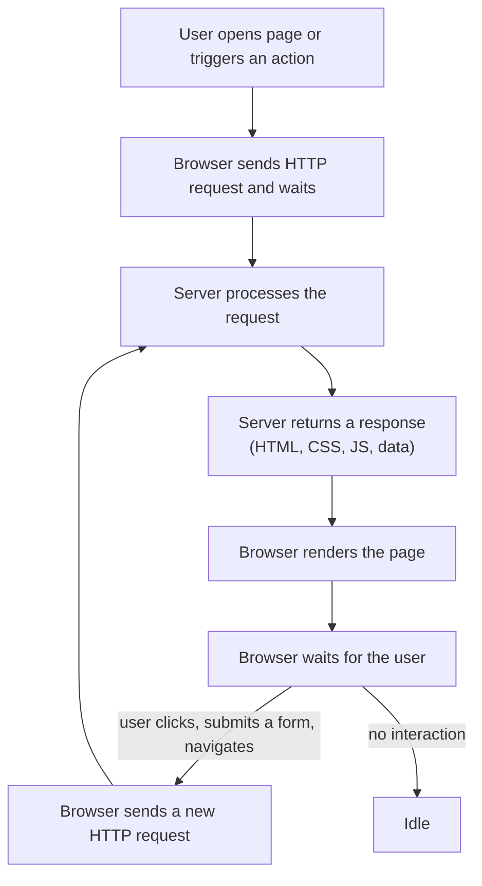

# Frontend Fundamentals (HTML / CSS / JS)

The **frontend** is the part of an application that the user directly sees and touches. It has three jobs:

1. **Display** what the server sends (text, tables, images, layouts)
2. **Collect input**: clicks, typing, navigation
3. **Communicate** with the backend: send the user's input and receive data over HTTP

A frontend does not have to be a web page. It can be a desktop GUI, a mobile app, a browser, or the tiny interface of an embedded device. The differences:

| Frontend | Built with | Trade-off |
| -------- | ---------- | --------- |
| **Browser-based (web) app** | Web standards: HTML, CSS, JavaScript | Runs everywhere a browser runs; limited access to the system |
| **Native app** | Platform APIs (Windows, Android, iOS) | Tight system integration; written separately for every platform |

Because every browser implements the same standards, one web page looks (roughly) the same on Windows, Android and iOS. That portability is the main reason web frontends are so common.

## The three building blocks

| Language | Question it answers | What it does |
| -------- | ------------------- | ------------ |
| **HTML** | *What* to show? | Structure and content: headings, paragraphs, lists, tables, forms |
| **CSS** | *How* to show it? | Presentation: layout, colours, spacing, fonts |
| **JavaScript** | *What happens* when the user acts? | Behaviour: react to clicks, change the page, talk to servers |

> [!NOTE]
> **Separation of concerns.** Keeping structure (HTML), style (CSS) and behaviour (JavaScript) apart means you can restyle a site without touching its content, and lets the user's browser apply its own settings (large fonts, dark mode, a screen reader). It also makes the page more accessible, see [Accessibility](8-async-dom.md#accessibility-and-best-practices).

### What JavaScript is used for

* Manipulating HTML elements (buttons, links, forms): see [DOM Manipulation](8-basic-dom-manipulation.md)
* Handling user interaction (clicks, typing, navigation)
* Updating part of a page **without reloading it**
* Communicating with servers through APIs (`fetch`, AJAX): see [Asynchronous Updates](8-async-dom.md)

JavaScript is the only language every browser runs natively. Other languages reach the browser in one of two ways:

* **Transpilation**: you write TypeScript (or a newer JavaScript version) and a tool *translates* it into plain JavaScript that the browser can run.
* **WebAssembly**: code in C/C++/Rust is compiled to a binary format that browsers run next to JavaScript: see [WebAssembly](8-wasm-and-browser-security.md#webassembly-wasm).

(Projects such as `Brython` and `PyScript` run Python in the browser, but they are built on top of JavaScript/WebAssembly and are far less common.)

### JavaScript engines

The program inside the browser that executes JavaScript is the **JavaScript engine**.

| Browser | Engine |
| ------- | ------ |
| Chrome, Edge, Brave | **V8** |
| Firefox | **SpiderMonkey** |
| Safari | **JavaScriptCore** |

JavaScript is not limited to the browser. **Node.js** embeds V8, so the same language can run on a server or on your laptop outside any browser. (This is why the examples in [JavaScript Basics](8-javascript-basics.md) can be tried either in the browser console or with `node`.)

### Not every client is a person with a browser

An **embedded device** (for example a temperature sensor) may have no screen, no HTML and no JavaScript. It still talks to the server over HTTP, usually sending JSON to an API endpoint. Such a program is called a **machine client**. The server must expect these too: it does not know (or care) whether a human or a script sent the request.

```bash
curl -X POST -H "Content-Type: application/json" \
     -d '{"sensor":"t1","celsius":24.5}' http://localhost:5000/sensor
```

A Flask route that receives it gets the parsed JSON through `request.get_json()` and replies, for example, `{"received": {"celsius": 24.5, "sensor": "t1"}, "type": "application/json"}`. The same fact matters again in [Client-Side Validation](8-client-validation.md): a server that serves a form must still handle requests that never went through that form.

## Where does the HTML come from?

The central question of this page: **at what moment, and on which machine, is the final HTML put together?**

| Approach | HTML is produced... | Typical tools |
| -------- | ------------------- | ------------- |
| **Static page** | once, **ahead of time** (build/deploy); the server only hands over a file | hand-written HTML, Jekyll, Hugo, Gatsby |
| **Server-side rendering (SSR)** | on the **server**, for each request | Flask + Jinja2, Django templates, Rails, PHP, WordPress |
| **Client-side rendering (CSR)** | in the **browser**, by JavaScript, from data fetched as JSON | React, Angular, Vue |

*Static vs dynamic* describes the **content** (the same for everyone and fixed, or personalised and changing). *SSR vs CSR* describes **where the page is assembled**. A dynamic page can be built either way.

> [!NOTE]
> Frameworks such as **Next.js** can do all three: build some pages ahead of time, render others on the server, and hydrate the rest in the browser. So "Next.js = static site generator" is only part of the picture.

### Seeing the difference

The same fruit list, once rendered on the server and once in the browser:

```python
from flask import Flask, jsonify, render_template_string

app = Flask(__name__)
ITEMS = ["apple", "banana", "cherry"]


@app.route("/ssr")
def ssr():
    # SSR: the server builds the list, so the HTML already contains the data
    return render_template_string(
        "<h1>Fruits</h1><ul><li>{{ i }}</li></ul>", items=ITEMS)


@app.route("/csr")
def csr():
    # CSR: the server sends an empty shell and a script; the script fetches the data
    return """<h1>Fruits</h1><ul id="list"></ul>
<script>
fetch('/api/items').then(r => r.json()).then(items => {
  for (const i of items) {
    const li = document.createElement('li');
    li.textContent = i;
    document.getElementById('list').appendChild(li);
  }
});
</script>"""


@app.route("/api/items")
def api_items():
    return jsonify(ITEMS)
```

What was measured when this app was run (Flask, Chromium):

| | `curl /ssr` | `curl /csr` | browser on `/ssr` | browser on `/csr` |
| - | ----------- | ----------- | ----------------- | ----------------- |
| Does the downloaded HTML contain `apple`? | yes (`<li>apple</li>`) | **no** | n/a | n/a |
| HTTP requests the browser makes | n/a | n/a | 1 (`/ssr`) | **2** (`/csr`, then `/api/items`) |
| `<li>` elements visible after loading | n/a | n/a | 3 | 3 (`apple`, `banana`, `cherry`) |

Both pages look identical to the user, but:

* With **SSR** the first response is already the finished page. Anything that reads only the HTML (a search-engine crawler that does not run JavaScript, a link-preview bot, `curl`) sees the content.
* With **CSR** the first response is an empty shell. The content appears only after JavaScript runs and a **second request** returns. That is the "extra round trip" that makes the first load slower. After the first load, however, only small JSON responses are needed instead of whole pages.

### Comparison

| Feature | Server-Side Rendering | Client-Side Rendering |
| ------- | --------------------- | --------------------- |
| First page load | Faster: content is in the first response | Slower: shell, script, then data requests |
| SEO | Content is in the HTML, so any crawler sees it | Depends on the crawler running JavaScript (many do, but it is less reliable); pre-rendering helps |
| Later interaction | Full page reload, or AJAX for parts | Only data is exchanged, so updates feel instant |
| Server load | Higher: renders every page | Lower: sends data (JSON) |
| Client load | Low | Higher: the device runs JavaScript |
| Template logic lives in | Server | Browser |
| Examples | Flask, Django | React, Angular, Vue |

| Approach | Advantages | Limitations |
| -------- | ---------- | ----------- |
| **Static pages** | Very fast, trivially cached, can be served from a CDN, simple to host and secure | Changing content means rebuilding and redeploying; little personalisation |
| **Server-side rendering** | Flexible and personalised (login, live data); sensitive logic stays on the server | More server work per request; more database hits (cost, latency) unless cached |
| **Client-side rendering** | Highly interactive; offloads work from the server | Needs a capable device; any logic or data sent to the browser can be read by the user, so it must not contain secrets |

## The original web model: synchronous page reload

In the earliest web applications:

1. The browser sends a request.
2. The server replies with a **complete HTML page**.
3. The browser throws away the old page and renders the new one.

*Every* user action that needs new data repeats this cycle, even if only one number on the page changed. Consequences: the server regenerates whole pages (high load), most of the transferred data is a repeat of what the browser already had (redundant transfer), and the user sees the page flash and reload.

(The browser does not necessarily download CSS, JavaScript and images again, because of caching, covered below. The HTML, though, is rebuilt and re-sent each time.)



## Modern browsers share the work

To avoid the full-reload cycle, modern pages move part of the work to the browser:

* JavaScript runs on the **CPU** and updates only the part of the page that changed.
* Animations and graphics may use the **GPU**.
* The server mostly sends *data* (JSON) rather than whole pages.

This lowers server load and makes pages feel responsive, but the **cost moves to the user's device**: more CPU use, more battery drain, and a slow page on an old phone. (Open the browser's Task Manager, or your OS's, while a heavy page runs, and you can see a tab using real CPU and memory.)

### Optimisation techniques

| Technique | Idea | How it helps |
| --------- | ---- | ------------ |
| **Caching** | Keep a copy of something already fetched | Avoids repeating the request, or at least the transfer |
| **CDN** (Content Delivery Network) | Copies of static files on servers around the world | The user downloads from a nearby server: lower latency, less load on your server |
| **Minification and bundling** | Remove whitespace/comments, shorten names, merge many files into few | Smaller files and fewer requests. Servers usually also **compress** (gzip/brotli) what they send |
| **Lazy loading** | Load a resource only when it is about to be needed | The page appears sooner; images the user never scrolls to are never downloaded |

**Caching in detail.** The server can attach validators to a file. Flask's static-file route, for example, sends `ETag` and `Last-Modified` and `Cache-Control: no-cache`. Despite the name, `no-cache` does *not* mean "do not store": it means "you may store it, but **ask me before reusing it**". Asking is cheap:

```bash
curl -i http://localhost:5000/static/style.css
# HTTP/1.1 200 OK
# Cache-Control: no-cache
# ETag: "1700000000.0-1000-123456789"
# Last-Modified: Wed, 25 Nov 2026 18:35:07 GMT
# ... (the whole file follows)

curl -i -H 'If-None-Match: "1700000000.0-1000-123456789"' http://localhost:5000/static/style.css
# HTTP/1.1 304 NOT MODIFIED
# (no body: the browser reuses its stored copy)
```

The server answered `304 Not Modified` with an **empty body** because the `ETag` still matched. (The exact tag value differs for every file.) A `Cache-Control: max-age=...` header goes one step further: the browser reuses the copy without asking at all until it expires.

**Lazy loading** is a one-word change in HTML:

```html

```

In a Chromium test page with three images placed far below the fold, the browser fetched all 3 immediately without the attribute, but with `loading="lazy"` it fetched only the one near the viewport until the page was scrolled, and then the other two. (Browsers decide the exact trigger distance; the point is that off-screen images wait.) Giving `width` and `height` lets the browser reserve space so the page does not jump when the image arrives.

## Summary

* **Content generation**: build-time (static), request-time on the server (SSR), or in the browser (CSR).
* **Performance** is a balance between client and server work, helped by caching, CDNs, minification and lazy loading.
* **Security**: whatever runs in the browser is visible to and changeable by the user. Never rely on the client for secrets or for checks that matter.
* **Code reuse**: component frameworks (React, Angular, Vue) let you build a page from reusable pieces.

## Practice questions

<details>
<summary>1. A page shows a product list. <code>curl</code> on the URL returns an HTML file with no products, yet the browser shows them. Which rendering approach is this, and what does the browser do that curl does not?</summary>

Client-side rendering. The browser **executes the JavaScript** in the shell, which calls an API (a second request) and builds the list with the DOM. `curl` only downloads the HTML and never runs the script.
</details>

<details>
<summary>2. Is a static site the same as a site with no JavaScript?</summary>

No. "Static" means the HTML files are prepared ahead of time and served unchanged. Those pages can still contain JavaScript that fetches data or reacts to clicks.
</details>

<details>
<summary>3. A server replies <code>304 Not Modified</code>. What was sent and what is saved?</summary>

Only headers: there is no body. The browser had sent the validator (`If-None-Match` / `If-Modified-Since`), the server found nothing changed, so the browser reuses its stored copy. The saved resource is the transfer of the file itself, not the round trip.
</details>

<details>
<summary>4. Give one advantage and one disadvantage of moving work to the client.</summary>

Advantage: lower server load and a more responsive page (only data is exchanged). Disadvantage: the user's device does more work (battery, slow hardware), and anything the client does can be inspected or bypassed, so it cannot be trusted.
</details>
